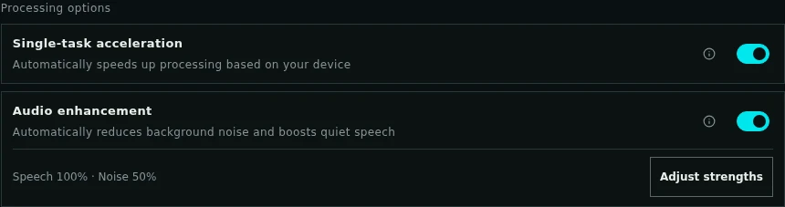
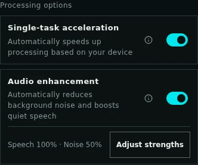

# Local ASR audio enhancement / 本地 ASR 音频增强

## Browser control / 网页总开关

The audio and video forms expose one **Audio enhancement / 音频增强** switch,
enabled by default. It submits `audio_enhancement=auto` to enable denoising followed
by continuous speech gain, or `off` to disable both. Advanced settings let users
adjust each strength and reset both to server defaults; the default waveform is unchanged.

The stacked Processing options rows are visible when transcription settings are expanded, including on mobile.
Saved strengths appear beside Adjust strengths, with custom values marked and zero shown as Skip.
Switching off shows Use original audio and disables adjustments while retaining the saved values.
Component availability is shown separately; a missing denoiser does not disable speech gain.

ASR preferences retain their existing localStorage lifetime under schema v7. Published
v0.1.33 schema v4 and development v6 combined preferences keep their value and receive server-default strengths.
Migration from v5 enables the combined control if either independent control was
enabled; both disabled stays off. The migrated v5 key is removed. Earlier combined
`auto`/`off` preferences keep their value. Content/session draft clearing is
unchanged. Paused video uploads retain their original submitted parameters,
including historical independent combinations; the new switch does not rewrite
their saved request. Historical task requests and results remain unchanged.

网页音频、视频表单统一使用“音频增强”总开关，默认开启，同时控制背景降噪和人声增益。
浏览器偏好升级到 v7：正式版 v0.1.33 的 v4 和开发版 v6 总开关保持原值并补入服务端默认强度；开发版 v5 两项任一开启则迁移为开启，均关闭则保持关闭；旧总开关的
开启／关闭偏好保持原值，存储期限和草稿清理行为不变。暂停的视频上传仍使用原参数。

### Processing options preview / 处理选项预览

Screenshots use isolated mock jobs with synthetic audio; applied enhancement is a
synthetic UI fixture, not inference-quality evidence. Reproduce with
`scripts/capture_readme_assets.mjs` against a separately started local mock service;
see the [development setup](../CONTRIBUTING.md#development-setup). Set
`AUDIO_INTEL_CAPTURE_BASE_URL` to its URL. The script captures both locales at
1440 px and 390 px, exercises the adjustment dialog, and checks console errors and overflow.

| Locale / 语言 | Desktop / 桌面 | Mobile / 手机 |
| --- | --- | --- |
| 中文 |  |  |
| English |  |  |

## Advanced strengths / 高级强度

在“处理选项”开启总开关后，点击“调整参数”可打开“增强高级设置”，分别使用滑块或数值输入调整两项力度。有效修改立即保存，
“一键恢复默认强度”只重置这两项，不改变模型、语言或其他 ASR 偏好。关闭总开关后保存的
强度仍保留；暂停上传期间参数锁定。偏好仅影响新提交任务，不会重新处理已有结果。

| API field / 参数 | Range / 范围 | GTCRN default / 默认 | Meaning / 含义 |
| --- | --- | --- | --- |
| `speech_enhancement_strength` | 0–2 (UI 0–200%) | 1 (100%) | Multiplier on desired dB gain before safety limits / 安全约束前的目标 dB 增益倍率 |
| `background_denoise_strength` | 0–1 (UI 0–100%) | 0.5 (50%) | Denoised-signal mix on automatically selected blocks / 自动判定需降噪片段的湿声混合比例 |

三种 ASR 入口均接受上述参数，音频及 OpenAI 兼容入口用 multipart，视频用 JSON。
可与总开关或兼容布尔开关配合；总开关和布尔开关仍不能混用。范围外、非有限数返回 `422`。
`0` 跳过对应操作（`bypassed / strength_zero`），降噪为 0 时不加载降噪模型；总开关 `off`
始终关闭两项。干净片段仍自动旁路，不会因为调高强度而强制降噪。

Capabilities are authoritative: each operation exposes `strength: {min,max,step,default,unit}`.
The administrator's experimental UL-UNAS backend advertises a default mix of 1.0;
the browser reads the server default, rather than assuming GTCRN. Default gain is 1.0.
Higher settings can reduce naturalness or recognition accuracy. A 100% mix means
fully wet audio on selected blocks, not removal of all background sounds. Gain
keeps the +24 dB cap, 3 dB/s slope and −1 dBFS processed peak ceiling.

Policy 6 snapshots both numeric strengths, including when enhancement is off; per-operation
results optionally report `strength`. Replay inherits omitted strengths, and changed
values return `409`. Historical policies ≤5 remain unchanged on replay/retry;
supplying new numeric fields for a historical idempotency record returns `409` and
requires a new key. ETA cohorts include strengths only for policy 6. Adding numeric strengths requires no database migration, historical waveform rewrite,
model change or dependency change; the release also includes the experimental
denoiser described below.

## Independent controls / 独立开关

API clients can continue to submit `speech_enhancement` and `background_denoise`
booleans, both defaulting to `true`. These compatibility fields remain available
for existing integrations and saved tasks. The browser and recommended API
examples use the combined `audio_enhancement=auto|off` control.

| Speech gain / 人声增强 | Denoising / 背景降噪 | Processing / 处理 |
| --- | --- | --- |
| false | false | Original signal / 原音 |
| true | false | Continuous upward gain, no denoiser loaded / 仅连续轻声增益 |
| false | true | Denoising without speech gain / 仅降噪 |
| true | true | Denoising followed by continuous gain / 先降噪再增强 |

Policy 5 separates these operations and reports their individual
`enabled`, `status` and `reason` under `audio_enhancement.speech_enhancement`
and `.background_denoise`. Denoiser failure does not block gain; an applied
result can have `reason=partial_fallback`. Always inspect both outcomes.
Capabilities publish availability/defaults for each operation. Gain requires no
extra model. Both operations run on local CPU independently of the ASR device.
Original playback plus at most one processed track are retained.

推荐总开关 `audio_enhancement=auto|off` 统一开启／关闭两项；不能与独立字段混用，
否则返回 422。新任务保存组合、策略版本和服务端选定的降噪后端，不能通过请求指定模型。
重放省略字段时继承已保存值；改变开关返回 409。未保存独立开关的历史任务继续走旧处理链，
历史缺少增强字段仍按关闭解释；不迁移既有任务、媒体或声纹。

The recommended combined control enables/disables both and cannot be mixed with independent
fields (422). New jobs snapshot the effective controls, policy and server-selected
backend. Replays inherit saved values; changed controls conflict (409). Historical
requests retain their previous path on replay/retry; a missing legacy field means
o enhancement. No persistent migration is performed.

### Stronger-denoiser experiment / 更强降噪实验

Current policy 6 retains the validated 50% GTCRN mix and continuous gain
introduced in policy 4. Defaults retain the previous suppression; advanced overrides are optional. A pinned
[UL-UNAS DNS3](https://github.com/Xiaobin-Rong/ul-unas/tree/00f7c700da43d38347f30a6ccebd86fcbc798e07)
candidate is included with its [MIT license](../asr/licenses/UL-UNAS-MIT.txt).
It uses existing Torch/NumPy on CPU FP32, without extra Python dependencies.
Setup downloads manifest-owned weights and verifies revision and SHA-256;
runtime never downloads them. Native reshapes replace upstream einops and ISTFT
explicitly preserves input length, including the tail.

在 11 个公开控制样本、10 个可信文本参考的配对测试中，UL-UNAS 的 100% 与 75%
配置均使两个噪音样本的 CER 相对当前方案上升，因此未通过“不降低识别准确率”的门槛，
不作为日常默认，也不宣称已实现更强降噪。管理员实验可设置
`AUDIO_INTEL_ASR_DENOISE_BACKEND=ulunas`；恢复 `gtcrn`（默认）即可回退。该变量仅在
首次接受新任务时选择 manifest 模型；刷新 API 和 worker 后生效，已保存请求不改变。
试听必须比较讲话期间的背景声和轻声字尾，不能只看停顿音量或平均响度。

Both 100% and 75% UL-UNAS arms increased CER on two public noisy controls relative
to the current baseline; they fail the no-regression gate and remain experimental.
The administrator-only `AUDIO_INTEL_ASR_DENOISE_BACKEND=gtcrn|ulunas` selects the
manifest model for new policy-6 requests (default `gtcrn`). Refresh service processes
after changing it; persisted requests keep their backend. This is not a public
model selector. Missing/invalid weights never disable base ASR or independent gain.

New audio and video transcription requests default to `audio_enhancement=auto`.
Use `off` to retain the previous recognition input. Automatic enhancement keeps
all conversation speakers: it suppresses environmental noise and lifts quiet
speech, rather than selecting one target speaker. Background conversations and
severe reverberation can remain; missing recorded speech cannot be reconstructed.

新音频、视频转写默认自动判断是否需要增强，支持显式关闭。人声增强分别判断降噪和增益：
较远、较轻的人声可提升局部音量，噪音较大的片段可保守降噪；干净且音量充足的片段直接旁路。
保留全部交谈参与者，不承诺去除其他人的闲聊，也不承诺恢复录音中缺失的内容。

## Offline installation and processing / 离线安装与处理

`./service.sh setup asr` (Windows: `service.cmd setup asr`) downloads the pinned
GTCRN DNS3 and experimental UL-UNAS DNS3 checkpoints declared in
`audio_intel/model_manifest.json`. Downloads
use an immutable upstream commit and verify the weight checksum. Runtime loading
requires the matching `.complete` revision and checksum and runs locally on CPU,
independently of the selected ASR CPU/GPU device. No new inference environment,
Python dependency, cloud API, or model source is accepted from a request.

The inference source is adapted from GTCRN under the [included MIT license](../asr/licenses/GTCRN-MIT.txt).
Existing Torch, NumPy and Qwen pins are preserved. A missing enhancer does not
disable the base ASR models: current policy 6 skips unavailable denoising and still attempts speech gain.
Only when neither operation produces usable enhanced audio does the task use
original audio with aggregate `fallback`; inspect both operation results.

Models are evaluated in bounded blocks with context. The current conservative
mix retains 50% original signal. Speech gain targets −24 dBFS RMS, is capped at
+24 dB, and uses a cubic soft transition from −33 to −27 dBFS instead of a hard
−30 dBFS switch. Processed blocks have a −1 dBFS peak ceiling; untouched blocks
retain original samples and peaks.
These safety limits remain fixed; advanced strengths scale desired gain and denoising mix without changing them.
Current policy 6 retains policy 4's continuous gain: after the GTCRN mix it estimates a
continuous gain curve using the 70th-percentile speech RMS in six-second centred
windows. Estimates update every 20 ms. Peak limits and forward/backward constraints
bound gain changes to 3 dB/s across the whole file, including processing boundaries.
Short gaps hold the previous estimate for two seconds; longer gaps release gently
to unity gain. VAD supplies statistics without directly gating signal volume.
Policy 3 removed policy 2's pause gate but retained per-second gain decisions,
which could still cause substantial within-phrase background-level changes.
A failed second VAD retains base enhancement and the original speech regions.
Adjacent processed blocks crossfade over 50 ms, avoiding a return to raw noise at
each 30-second boundary. Untouched files still bypass sample-exactly.

当前策略 6 保留策略 4 引入的连续增益、原有响度目标与 50% GTCRN 混合；
策略 4 将逐秒增益改为跨块连续增益，策略 5 增加逐项状态和独立恢复。
6 秒上下文估计和每秒最多 3 dB 的变化限制，减少背景声跟随词句突然起落；保留自然轻重，
不逐词拉齐音量。平均响度和识别误差不能充分反映憋气感，仍需本地、响度匹配的听感对比。
基础混音与最终输出分两遍写入，预检两份 PCM WAV 的临时空间，约每小时 230 MB；
中间文件在完成、取消和失败后清理，最终产物数量不变。能量统计按 20 ms 帧保存并分块
计算上下文，模型与音频读取仍使用有界块。阶段进度累计各遍实际处理的工作量。
The original and enhanced VAD intervals are merged without changing the existing
ASR chunk-combination rules. Speaker clustering and voiceprint embeddings use
original audio. Enhancement preserves sample count and the video time origin.

The historical `AUDIO_INTEL_ASR_CONTINUOUS_GAIN=0` override applies only to
legacy requests without `enhancement_policy_version` 5 or 6: it selects policy 3
instead of policy 4 after process refresh. It does not roll policy-5/6 jobs
back to policy 3. Historical saved requests are never upgraded by replay/retry.
For current jobs, `audio_enhancement=off` disables enhancement; the administrator
`AUDIO_INTEL_ASR_DENOISE_BACKEND=gtcrn` selects the validated denoiser for newly
accepted policy-6 jobs after refreshing API, supervisors and executors.

旧回退变量 `AUDIO_INTEL_ASR_CONTINUOUS_GAIN=0` 仅作用于未保存策略 5/6 的历史处理链，
在刷新进程后选择策略 3；它不会把策略 5/6 任务回退到策略 3。历史请求重放／重试仍
使用保存的处理语义。当前任务用总开关 `off` 关闭增强；降噪后端回退仅影响新提交任务。

## Request and result / 请求与结果

- Audio ASR and `/v1/audio/transcriptions`: multipart field `audio_enhancement=auto|off`.
- Video transcription: JSON property `audio_enhancement` on `/api/v1/asr/video-jobs`.
- `/api/v1/capabilities` reports `asr.audio_enhancement`, including availability,
  default, modes, model revision and CPU execution.
- Job detail/results optionally contain `audio_enhancement`: requested mode,
  `off`, `bypassed`, `applied` or `fallback` status, reason, revision, gain and
  processing time. Applied results include an enhanced playback URL and waveform.
- Original `/playback` and source downloads retain their meaning. `enhanced.wav`
  is a separate authenticated artifact with Range support and normal task purge.
  No extra audio file is retained when the entire task is bypassed.

`gain_seconds` and `denoised_seconds` report the coverage of blocks that applied
each operation, not exact voiced duration. `elapsed_seconds` measures the
enhancement function, excluding subsequent VAD and other task stages. A changed
transcript alone does not establish improved recognition accuracy. Enhancement
progress in `media_second` accumulates work across processing passes; it is not
the recording duration. Read `result.duration` for the audio duration.

New tasks report `processing_version=6`; policies 4 and 5 are historical. Optional
`pause_attenuated_seconds`,
`max_pause_attenuation_db` and `pause_suppression_reason` identify actual processing.
Pause duration counts samples receiving attenuation, not exact non-speech time;
the maximum is a positive dB reduction. Policies 4, 5 and 6 report both attenuation
fields as zero and the reason `disabled_for_naturalness`. Historical policy-2/3 results
remain valid; policy 3 does not imply continuous gain. Missing fields do not imply successful pause suppression. Timing
includes signal processing and excludes VAD.

增强参数纳入幂等比较：同一 key 不能切换增强模式。历史请求缺少该字段时按关闭解释，
省略字段重放旧请求仍返回原任务；旧失败/取消任务重试保留原请求。不会自动改写历史媒体、
声纹样本、克隆参考或已有任务结果。声纹导入和克隆参考分析不启用此处理。

The UI keeps the original audio selected initially and offers enhanced playback
and download when available. Switching tracks preserves position and playback
state, with the waveform following the selected track. The combined preference
uses ASR v7 localStorage with its existing lifetime; draft and sessionStorage clearing
rules remain unchanged. Historical results without the field imply no recorded
enhancement, not successful processing.

原音／增强音控件将“试听”分段选择与“下载原音／下载增强音”分组，手机上两组分行。
下载原音提供播放器中未增强的 WAV（视频任务同样下载音轨 WAV），不改变试听音轨或进度。
没有增强音时仅提供原音下载；历史任务未保留原音 WAV 时显示不可用，不自动补生成。

Original/enhanced track selection is grouped separately from the two downloads; mobile uses two rows.
Original download serves the saved unenhanced playback WAV, including the audio track of video jobs,
without changing listening state. Jobs without enhanced audio offer only original download;
historical jobs without a saved original WAV show an unavailable explanation and are not backfilled.

## Local paired validation / 本地配对验证

For reproducible public controls, first use the separate TTS environment (never
install qwen-tts into ASR or qwen-asr into TTS):

```bash
.runtime/tts/bin/python scripts/create_asr_enhancement_fixtures.py \
  --output-dir testdata/real/asr-enhancement --device gpu
```

The producer uses fixed public phrases, speaker levels, seed, noise mixtures and
transient peaks. Verify the clean transcription before interpreting synthetic
reference scores. Then run in the ASR environment after installing the pinned models:

```bash
.runtime/asr/bin/python scripts/benchmark_asr_enhancement.py \
  --cases-json testdata/real/asr-enhancement/cases.json \
  --device gpu --model qwen3-asr-1.7b \
  --output-dir logs/asr-enhancement-validation
```

The local case file is a JSON list of `{id,path,start?,end?,reference?}`; each
`reference`, when supplied, must be a trusted transcript verified locally.
Use `--job-id ID` to inspect an existing task without changing it, optionally
`--full` for complete audio. The default arms compare original, gain only,
denoise only, and 25%, 50%, 75% enhanced mixes with gain. They use the production VAD union and ordered chunk rules; `--fixed-vad`
keeps the original boundaries when isolating signal processing. Socket connections are blocked during analysis.

For extended controls, reuse public speech without another TTS call:

```bash
.runtime/tts/bin/python scripts/create_asr_enhancement_fixtures.py \
  --speech-dir testdata/real/asr-enhancement --extended \
  --output-dir testdata/real/asr-enhancement-extended
```

Benchmark `auto`, `no_pauses` and `mix50` use policy 4 without pause gating.
`mix60`, `mix65` and `mix75` compare stronger mixing without gating; `pause_gate`
explicitly reproduces retired policy 2, and `legacy_gain` reproduces policy 3's
GTCRN mix with per-second gain. Both are local diagnostics, not public request
modes. Save a frozen
pre-change baseline first; `--baseline-report` reuses its original transcription
only when model, device, cases, durations and normalized audio match. Compare CER
to that baseline where trusted references exist, and match speech loudness for listening.

For timing-specific incidents in a long recording, process each complete audio arm
first and then extract identical sample ranges for listening and ASR comparisons.
Independently enhancing short excerpts resets model context and gain estimates;
those outputs are not a matched baseline for a full-file result.

The historical policy-2 public comparison used the four original controls and seven extended
controls generated above. With Qwen3-ASR 1.7B on GPU, the ten cases with trusted
ordered references retain the v0.1.33 CER at a 50% mix. Steady-noise safe pauses
drop about 5.8–6 dB while speech-region RMS remains unchanged to measurement
precision. Increasing the mix to 60%, 65% or diagnostic 75% adds one character
error in the original noisy control, so production retains 50%. The overlapping
speaker control has no trusted ordered transcript and is not included in CER.
Transient-dominated gaps received little reduction. Subsequent listening feedback
reported audible pumping despite those aggregate measurements. Policy 3 therefore
removed the pause gate; policy 4 additionally replaces per-second gain. The old pause-reduction numbers do not describe the current
default or establish subjective listening quality or noise removal during speech.

Reports, media and transcripts must stay under ignored `logs/`, `tmp/` or
`testdata/real/`. Standard output contains anonymous measurements, never private
transcripts. Cases without trusted references report text agreement, not accuracy.
PESQ/STOI or true SNR require a clean reference and must not be inferred from a
private noisy recording alone. Keep private fixtures and outputs out of Git and CI.

Verify quiet/noisy speech, missed speech, noise-only hallucinations, speaker
preservation, boundaries, clipping, full-length media clocks and added resources.
For clean audio, automatic bypass must preserve the existing decoded samples.
Listen locally to both tracks; improved listening quality does not by itself
establish improved recognition accuracy.

### Policy-6 strength validation / 策略 6 力度验证

The local 2026-10-17 paired run used the existing eleven public controls (ten with
trusted ordered references), with network connections disabled. Default policy-6
output matched the frozen pre-change implementation byte-for-byte on all eleven.
With Qwen3-ASR 1.7B GPU, mean per-case CER was 0.115% for both previous and default
strengths, 0.575% for weak (gain 0.5 / mix 0.25), and 0.230% for strong (2 / 1).
The four original controls on 0.6B CPU gave 0.287%, 0.862% and 2.299% respectively.
These small public controls demonstrate adjustable behavior and default parity;
they do not establish a universally best strength or subjective listening quality.
All arms preserved sample counts and finite audio; stronger settings retain the
existing limits (PCM16 quantization allows at most one sample step at the ceiling).

Reproduce the strength comparison using the public case JSON prepared above:

```bash
AUDIO_INTEL_LOAD_ENV=0 .runtime/asr/bin/python scripts/benchmark_asr_enhancement.py \
  --cases-json testdata/real/asr-enhancement-public/cases.json \
  --device gpu --model qwen3-asr-1.7b \
  --modes off,split_both,strength_default,strength_weak,strength_strong \
  --output-dir logs/enhancement-strength-validation
```
