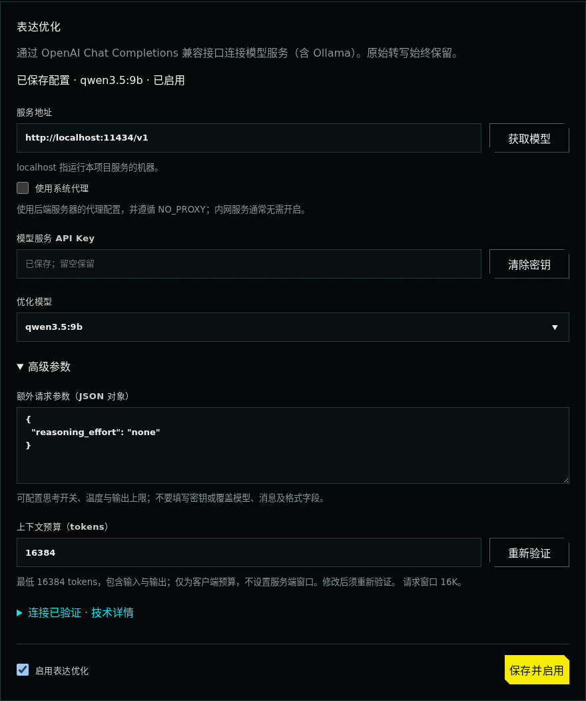
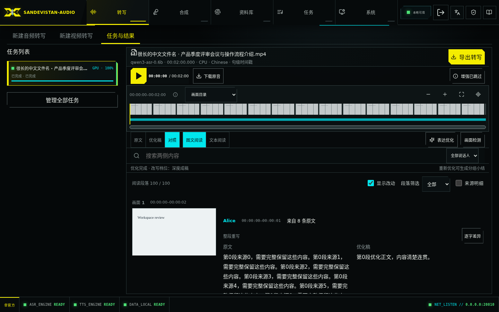

# 表达优化 / Expression optimization

在「系统状态 → 表达优化」配置 OpenAI Chat Completions 兼容服务的 Base URL、可选 API Key 与模型 ID，验证后保存并启用。Ollama 示例地址为 `http://localhost:11434/v1`；云服务使用其实际 API 地址与对应密钥。模型 ID 可手动输入；“获取模型”仅调用可选的 `/models`，列表不可用不妨碍手动验证。默认关闭，未保存修改不改变生效配置，也不会自动发送历史转写。优化只向明确配置的服务发送相关正文、候选及提交时的热词快照，不发送音视频、不提供隐式云端回退。localhost 指服务端所在机器。

API Key 通过密码框输入，存入服务端 SQLite 独立凭据表；网页仅获知是否已配置。密钥不会回传或写入浏览器 localStorage/sessionStorage，未保存的密钥只在当前组件内存中保留。成功保存或重新加载配置后输入框清空。省略密钥沿用同地址已有值，点击“清除密钥”表示保存时清除，换地址不继承旧密钥。同一连接换钥适用于引用它的历史任务；任务快照只记录凭据引用。SQLite 备份包含服务凭据，应按部署数据妥善保管。

“高级参数”接受 JSON 对象，例如 `{"thinking":{"type":"disabled"}}`，实际支持情况取决于模型服务。Ollama 的兼容接口可用 `{"reasoning_effort":"none"}` 关闭支持关闭思考的模型；旧连接迁移会填写该参数。不能覆盖 `model`、`messages`、`stream`、`response_format`、工具调用或鉴权字段。默认输出上限按工作阶段使用 4096 或 1024；可设置 `max_tokens` 或 `max_completion_tokens`（二选一），`temperature:null` 表示不发送温度参数。所有参数参与验证绑定及任务快照。

“上下文预算（K tokens）”默认16K、最低16K，包含输入与输出；另有默认4K的单次最大输出。1K=1024 tokens。预算仅用于客户端保守分片与预算检查，不设置也不证明服务端的实际窗口。Ollama 应使用服务端配置或 Modelfile 设置足够的 num_ctx。验证仅用合成文本确认正文和 JSON 输出，自动选择 JSON Schema、JSON Object 或提示词 JSON，正式任务继续执行本地结构与引用检查。

验证不加载或查询 Ollama 原生管理接口。连接详情显示验证时间与客户端预算说明；修改地址、代理、模型、密钥、预算或高级参数均使验证失效，可先关闭并保存未验证配置。正文、接缝、复核及小结统一通过 Chat Completions，遵守原有有界重试和检查点规则。容量或输出截断错误在正文阶段暂停并保留进度，小结阶段仍可按已保存策略使用有标记的兜底。不会将思考内容当作正文；思考开关由明确填写的高级参数决定。远端服务、模型和硬件会影响速度及质量。

全局窗口修改仅影响新任务，旧任务恢复继续使用原快照。需要降低旧任务窗口重跑时，使用「删除优化数据」再重新生成；该删除会清理该任务的已发布稿、候选和进度，原始转写及媒体保留，不会局部改写旧快照。

## 连续语句成稿

当前请求包仅对新版本连接验证后的 qwen3.5:9b 新运行启用，其他模型及旧验证配置继续原流程；不切换模型。已有9b连接只需在系统状态重新验证并保存一次，无需改预算、窗口或参数值。新验证明确发送 presence_penalty=0，高级参数显式设置或null仍优先，历史任务不变。

新请求包策略在说话人、画面归属、15秒停顿边界内，组合不超过约2400字的语义段；窗口较小时自动缩小。密集问答或口头重复较多的内容保留约400字的细分编辑单元，同一请求仍可处理多个独立单元。原来的全部细分小结保留在“分段小结”中，默认收起，搜索命中会展开，时间按钮可回听来源。展开状态只保存在当前组件内存中；没有新增浏览器持久偏好。优化稿API的JSON、Word、PDF及新策略的TXT导出包含全部细分小结；SRT/VTT仍只支持原始转写。

请求包按独立ID传输多个来源，正文生成后另发请求独立复核，同时可提炼该正文的小结；短任务可在第二次请求中完成复核、小结和画面标题。小结不是独立事实认证。引用无法定位时保留“未确定”提示。输出截断会在原输出上限内缩小请求包，不自动增大窗口；有效项先原子保存，再修复失败项。所有实际尝试均计入预算，暂停恢复不重新处理已保存内容。

纯英文请求使用英文示例，仍保留原有模式及来源约束。程序会拦截英文被翻译成中文、明显来源名称丢失，以及与本条没有实质词汇重合的正文，进入已有的有界修复流程；混合语种不强制改成英文。这些词汇检查用于防止明显跨条目内容混用，不是完整的语义或事实认证。

较长正文额外用本地规则清理明确停顿及部分重复口头词，在完整句末分开密集段落，不增加模型请求。含糊的业务词、责任关系和未回答问题仍保留，不通过猜测补成确定结论。原文不含相关内容时，小结若误写成编辑复核说明或无意义评价，会进入原有的有界修复与原文摘取流程。

单组不超过120字且无画面的短稿采用固定两步，计划从不可变来源和配置恢复，不额外写计划行。首轮仍实际调用模型整理正文；若结果与原文或字面清理完全一致，则程序核对来源即可，第二次请求只提炼小结，不伪称已由模型独立复核。正文有其他变化时，第二次请求仍独立复核并提炼小结。

请求计划单独存入不可变SQLite表，不把全文计划反复写入进度行；诊断每项最多保留12条、每条候选预览600字，不记录编辑前信息清单、不新增逐token日志或磁盘缓存。v25只增加表和可空字段；历史任务保留原策略及快照。新验证配置明确发送 presence_penalty=0，高级参数可显式覆盖或以null省略，已有历史配置的采样行为不变。实际降幅、速度及质量须以完整任务对照验收为准。

下面约240/400字阅读组、90/160字子批次和接缝流程描述历史策略；新策略通过请求包一次处理较完整的正文，仍保留相同来源边界和所有细分小结。

对已完成的普通音频或视频任务选择「表达优化」。按同一人连续发言整理，另一人的插话、超过 15 秒的停顿和画面边界形成新段。阅读段落目标约 240 字、最多 400 字；一幅画面可有多段。仅在有可靠字词对齐时拆分跨画面来源，否则完整片段归属最大重叠画面，不猜测时间。不会根据同名猜测说话人，也不会改变原始转写、字幕或音频时间轴。

| 档位 | API 值 | 效果 |
| --- | --- | --- |
| 自然润色 | `polish` | 清理重复、口头冗余和病句，保留交流语气。 |
| 流畅重写 | `rewrite` | 默认档位，重组句式和表达顺序，形成连贯的对谈稿。 |
| 深度成稿 | `editorial` | 更充分地整理为书面稿，保留事实与有效细节，不生成摘要。 |

三个档位都支持多条来源合并。模型接收本批所属的来源片段，借助任务热词修正明确的听写错误；不向生成请求提供相邻批次或其他人的正文，避免将邻文误当作当前内容。不把当前热词库的后续修改写回历史任务。有语义但不确定的局部词语保留，没有完整语义的截断尾片可省略，原始来源始终可对照；不能凭猜测补全事实、原因、时间或人物关系。原本清晰的短句可以不改；文字变化比例不是质量评分。

长来源组按实际预算分成持久化子批次，目标约 90 字、最多 160 字，优先完整句子，其次逗号边界；预算紧张时进一步缩小。一个批次仍可包含多条原始来源，最终按原顺序组成同一组成稿，不再次整体摘要。真正无自然边界的强制拆分进行有界接缝整理，版本号和小数中的点不作为句界。暂停恢复复用已保存的批次与结果，不重写完成部分或重复拼接。

生成正文通常只请求一次；仅空输出、长度异常、重复残留或限定词丢失允许一次定向修复，附带上次候选和具体问题。新任务的正文子批次最多3次模型请求（传输重试包含在内），不叠加内外层重试额度；已有可用改写不会因后续尝试失败而撤销。仍无法得到正文时执行基础整理，并明确记录 `generation_method`，不冒充模型完成了改写。持续连接故障保存进度，恢复服务后可继续；无法安全保存时如实报告运行故障。

生成同时检查少量明确限定词的范围是否丢失（如“不止”“未必”“只能”，接受明确同义表达），必要时复用一次加强机会；不会把普通“不／不是”或合理自我纠正一概认作错误。这是有限保护，不能证明所有事实均正确。

## 统一完成与辅助检查

表达优化是一次完整操作：生成正文 → 自动检查 → 小结与标题生成及必要的自动兜底 → 发布。检查完成前本次新稿不能阅读或下载，原文始终可用；重新优化时，同一画面划分下的旧完成稿继续可用，直到新稿整体完成。检查只添加提示，不撤销或回滚正文。

事实复核明确区分 `pass`、`fact`、`uncertain`。通过结论可包含肯定性说明，不因说明非空而判为格式错误。事实疑点需定位原文和成稿证据，引用允许空白与全角字符规范化，不做模糊语义替换。新建任务只复核一次，不因事实疑点再次询问相同模型；仅连接或 JSON 异常允许有界重试。证据引用无法在原文中定位时记录为不确定并保留诊断，不伪造引用、不改判通过。旧任务继续沿用其配置快照。

复核结果只是辅助，不能保证绝对正确。疑点、不确定、不可用和基础整理在完成摘要中提供详情，不能将未能检查当作通过。每个子批次最多两次检查请求、每次最多 120 秒；连续三个子批次出现连接或超时故障后，剩余检查记为不可用，仍交付已生成正文。

qwen3.5:4b 与 9b 的本轮实测仍有事实改变、复核漏报和整理不足；完整范围及未达标项见[验证记录](EXPRESSION_OPTIMIZATION_VALIDATION.md)。来源破碎或听写错误较多时，不能将模型结论当作事实认证。

暂停／继续作用于整个流程，恢复复用已保存的正文和检查点，无需单独发起复核。API 重启后未完成工作暂停，用户可继续；关闭功能也暂停未完成工作。删除优化或父任务取消相关请求并清理正文、子批次、检查记录和导出缓存。旧响应不能覆盖新稿或恢复已删除的数据。提示统计可能重叠，不应相加作为总段数。

## 阅读、对照和导出

原文保留原始片段，优化稿按阅读段落显示，对照完整显示每段原文和优化稿。桌面两侧并排，手机上下排列，共用正文滚动区；无需逐段展开原文。来源 ID、时间戳等通过全局「来源明细」开关查看。默认显示改动，大幅改写使用整段提示，可选择详细差异。

「原文／优化稿／对照」和「图文阅读／文本阅读」是两组独立选项，表达优化、画面检测和音频增强入口位置固定。三个版本保留同一时间轴，定位对应画面或阅读段落。搜索覆盖当前版本可见正文、小结及画面标题，对照也搜索两侧正文，提供高亮、前后命中跳转和清除筛选。统计区分原文片段、阅读段落和命中数，不把内部子批次当作阅读段落。

图文模式每幅画面左图右文，对照的右侧为两栏正文。正式应用新检测参数／画面划分或编辑边界，会在同一事务内清理旧优化数据并回到原文，之后可手动重新优化。仅编辑参数、预览、更换截图、改变导出隐藏状态或人物显示名不会清理成稿；应用失败保留旧划分和旧稿。

统一「导出转写」入口长期记忆内容、各内容格式、脱敏及替换规则；不可用选择临时回退，不覆盖偏好。弹窗说明将下载的版本和格式，可选择使用当前阅读版本；重新生成期间导出旧完成稿会明确提示。下载成功触发浏览器下载后关闭弹窗，失败保留选项。优化稿支持 PDF/DOCX/TXT，对照支持横向双栏 PDF/DOCX。段落和来源覆盖与页面一致，具体疑点保留标记，对照附脱敏原因。来源、正文和原因使用相同替换策略，导出不修改持久化原始文件。

## API 与脚本

所有接口沿用服务的 Bearer／浏览器会话认证。下列路径前缀为 `/api/v1`；字段详见本地 `/docs` 与 `/openapi.json`。

验证与保存请求接受整数 `context_length`（最低 16384）；省略时沿用匹配验证凭证或同连接预算，新连接默认 16384。配置响应提供 `protocol: openai_chat_completions`、`has_api_key`、`extra_body`、`structured_output_mode`；不返回 `api_key`。兼容字段 `observed_context_length`、`model_context_length`、`model_digest` 在新验证结果中为 null，不伪造服务端观测值。修改任一连接或生成参数均须重新验证。

| 方法与路径 | 用途 |
| --- | --- |
| GET/PUT `/settings/transcript-optimization` | 读取、保存配置 |
| POST `/settings/transcript-optimization/discover` | 获取模型 |
| POST `/settings/transcript-optimization/verify` | 内置合成样本验证，返回短期 verification_token |
| GET/POST `/jobs/{id}/transcript-optimization` | 状态／创建；GET 支持 ETag |
| POST `/jobs/{id}/transcript-optimization/pause`、`/resume` | `{run_id,phase:"workflow"}`；兼容旧 phase 值，均控制整个未完成流程 |
| GET `/jobs/{id}/transcript-optimization/result?run_id=...` | 正文、来源及复核详情 |
| DELETE `/jobs/{id}/transcript-optimization?purge=true` | 删除全部优化数据 |
| POST `/jobs/{id}/transcript-export` | 使用 text_version、optimization_id 导出 |

创建需 `Idempotency-Key`，正文为 `{regenerate:false,rewrite_mode:"rewrite"}`。首次 202、同请求重放 200、冲突 409、容量不足 429（Retry-After）；更换档位须重新生成，恢复沿用配置快照。原有限制和父任务校验继续适用。

结果 `complete`、`published` 和 `succeeded` 都表示正文生成、检查及首轮小结恢复流程已结束，具有可阅读和导出的成稿；小结是否全部有效交付需读取 `summary_status.counts`。摘要 `phase` 为 generation/review/summaries/complete，`reviewed_parts/total_parts` 表示实际保存的检查进度；疑点和不可用数量独立保留。未发布结果请求返回 409。全局任务列表和 SSE 仍只含摘要，不读取正文统计。

段落 `text` 是 v7 实际成稿；`sources`、`segment_ids` 保留不可变来源，`scene_ids` 最多包含一个归属画面，`merged_source_count` 为来源数。`generation_method` 区分 model/basic_cleanup/mixed；`review_outcome` 区分 pending/pass/fact/uncertain/unavailable。兼容字段 `review_status` 仅 pass 对应 accepted、fact 对应 needs_review，其余为 null；历史 null 不表示通过。旧策略的 candidate_text 保持兼容读取。

```bash
python3 scripts/optimize_transcript.py --url http://localhost:20815 --job JOB_ID --rewrite-mode editorial
python3 scripts/optimize_transcript.py --url http://localhost:20815 --job JOB_ID --resume
```

URL 应使用实际部署地址。客户端密钥通过 `AUDIO_INTEL_API_KEY` 提供，不写入 URL。默认等待整个流程完成后输出 JSON；旧 `--wait-review` 参数仅为命令兼容保留。

## 持久化与升级

从正式 v0.1.41（schema v19）到 v0.1.42（v22）为仅数据库的累积增量迁移。旧 Ollama 地址补 `/v1`，保留模型与预算，并填写 `reasoning_effort:none`；旧验证清除、启用关闭，未完成优化暂停。重新验证保存并启用后，可显式继续原检查点。不得将客户端预算当作实际服务端分配。已为 v22 且没有其他持久化迁移的实例，不需重复迁移备份。

历史迁移说明：策略 v7／SQLite v19 增加统一阶段和检查进度。v18 及更早版本升级至 v19 时，一次性清理旧音频和视频优化正文、候选及检查记录，用户需手动重新优化；v19→v20→v21→v22 增量迁移保留已有数据及检查点（见下方分组小结说明）。原始转写、媒体、人物、热词快照和模型配置保留。升级前做 SQLite 一致性备份，无需复制历史媒体；遵循[升级指南](UPGRADE.md)恢复服务并验收后清理临时备份。

档位与导出偏好继续长期保存，刷新、重开、退出登录和资料库替换后保留。阅读方式、搜索、位置、差异显示及新增来源明细开关属于当前任务浏览器会话，刷新保留、退出登录清理，最多保留 200 个任务，不存正文或密钥。差异显示默认开启，已有明确关闭的偏好继续尊重。

English: Policy v7 scopes bounded reading paragraphs to one scene and one consecutive speaker turn. Generation and bounded annotation-only checks form one workflow; only its completed draft can be read or exported. A previous published draft stays available during regeneration. Comparison shows complete source and draft prose; source metadata is optional. Applying scene boundaries invalidates old drafts transactionally. The historical v18-and-earlier→v19 migration clears pre-v19 optimization data once, while preserving original jobs, media and model settings. The additive v19→v20→v21→v22 migrations preserve existing drafts, candidates and insight checkpoints. Take a SQLite-only backup, restore the recorded deployment and verify it before removing the backup.

## 开发质量验证

云服务密钥从 `OPTIMIZATION_API_KEY` 读取，高级参数可通过 `OPTIMIZATION_EXTRA_BODY` JSON 提供；Ollama 示例可设置 `OPTIMIZATION_EXTRA_BODY='{"reasoning_effort":"none"}'`。不要把模型服务密钥与本项目客户端的 `AUDIO_INTEL_API_KEY` 混用。

固定合成／去标识化语料在 `tests/fixtures/optimization_quality.json`。`scripts/evaluate_optimization.py` 直接调用所选服务，不创建应用任务；必须显式指定服务和模型。先验证语料，再串行执行两个模型，避免竞争资源：

```bash
.runtime/api/bin/python scripts/evaluate_optimization.py --validate-corpus
.runtime/api/bin/python scripts/evaluate_optimization.py --base-url http://localhost:11434/v1 --model qwen3.5:4b --output tmp/quality-4b.json --repeats 3
.runtime/api/bin/python scripts/evaluate_optimization.py --base-url http://localhost:11434/v1 --model qwen3.5:9b --output tmp/quality-9b.json --repeats 3
.runtime/api/bin/python scripts/evaluate_optimization.py --base-url http://localhost:11434/v1 --model qwen3.5:4b --corpus tests/fixtures/optimization_quality_long.json --output tmp/quality-long-4b.json --repeats 1
```

Windows 使用 API 环境的对应 Python 路径。工具保存模型 ID、结构化输出方式、额外参数、策略及语料校验和、逐项输出和耗时；通用协议不提供可靠的服务版本或模型 digest；`--resume` 只恢复身份一致的结果。复核用预置候选独立测量，未知／不可用不从分母删除。语言改善和事实保留须对记录逐项独立审读，不能由改字比例自动认证。真实任务评测应复制到隔离测试目录，按来源范围比较并统计来源字数加权结果，不能修改用户任务来做测试。

## 界面示例与复现 / Interface examples

以下为合成测试内容，用于展示界面，不是模型质量证据。



[手机设置 / Mobile settings](assets/optimization/settings-390.png)



[手机对照 / Mobile comparison](assets/optimization/comparison-390.png)

在隔离 mock 服务运行 `optimization-workflow.spec.ts`、`video-enrollment.spec.ts` 和 `optimization-provider.spec.ts` 后，执行 `python3 scripts/collect_optimization_doc_assets.py` 收集截图。README 使用 `scripts/capture_readme_assets.mjs`，需设置 `AUDIO_INTEL_CAPTURE_BASE_URL` 为隔离服务地址，不能对正常部署创建演示任务。两个脚本仅使用合成任务；测试检查交互、控制台错误及桌面／390 px 横向溢出。

English: These synthetic fixtures demonstrate layout, not model quality. Run both named Playwright files together against an isolated mock service, then collect screenshots. README capture also requires an isolated mock service and must never seed the normal deployment.


## 分组小结与画面标题

新建表达优化任务默认在正文改写、复核之后提炼小结，完成一轮尝试才交付新稿。每组小结提炼 TOP1 观点、原文明示的支持理由、关键数字或期限；存在另一个独立重要观点时可以增加第二句。保持原文语言，中文等连续书写每句不超过50字，英文等分词书写不超过30词，混合语种按两种预算比例合计；标题分别不超过20字／10词。不为了补足要素编造理由、因果、主体或数字，只有整段为空、标点、口头填充或纯问候致谢才不生成小结；目录、介绍、引用说明、操作过程和含义不确定的内容仍算有效输入。

视频在现有画面边界内生成分组小结，再根据该画面的全部归属文本提炼一个标题。长画面逐层归纳，中间结果持久化；不会只截取开头。分组和原始时间轴保持原样。

小结显示在优化稿／对照版每组正文下面，对照时横跨两列，避免与任一侧正文混淆。视频图文阅读和文本阅读都有画面标题；画面目录追加标题，原文模式也可用目录标题。可搜索当前可见的小结和标题，命中计数、跳转与高亮一致。PDF/Word 优化稿及对照版包含小结和标题，并应用同一套关键词替换。原文导出、TXT 和字幕保持原格式。

小结策略 v2 在本次执行内自动恢复：先用独立的小结／标题提示生成一次，仅在格式、长度、数字或明确范围异常时定向修复一次，随后最多请求一次原文关键词提取。每项（长画面的每个归纳节点）总计最多3次模型请求，包含连接重试，最长60秒；第二句缺失或无效不阻塞合格的第一句。没有额外的模型语义复核循环，本地检查只是有限保护，并非事实认证。连续3次服务故障会跳过后续模型请求，仍为有内容的项选取原文短句／主题词；上下文或容量故障同样使用原文兜底。长画面仍处理全部来源并复用中间检查点。

关键词按完整原文短语去重、择取至长度合规，不因拼接过长就丢弃全部结果，也不截断数字及单位。只要存在通过来源与长度检查的可用关键词，就立即采用，标记为“关键词”，该项结束，不再执行原文兜底。模型关键词与原文兜底都记为 `ready`，分别标注“关键词”“原文要点”；页面、PDF/Word 使用同一标记和替换规则，状态中分开显示数量。`not_applicable` 仅用于确实无实质内容；无法保存、来源失效等真实运行故障不伪装成成功。

最终“原文要点”由程序规则摘取，不再调用模型：优先选取长度合适的原文子句，倾向含要求、预算、理由等信息的句子；没有合适子句时，再选择短语或长度受限的片段。不会默认复制整组全文，短分组可能恰好全部入选。中文小结50字、标题20字及其他语种预算仍有效。长画面处理全部来源后逐层归纳；最终兜底可能从已保存的分片归纳结果中摘取，不能将其一概理解为逐字引用原始转写。

只在新建或重新优化时启用 v2；旧 v1 优化稿仍可阅读、导出及显式补试，保留其原策略。用户主动暂停及服务重启后继续保持暂停，需要显式继续；本次执行内的自动兜底不等于后台无限重启任务。已发布稿的“补试未生成小结”仍作为暂停／遗留缺项的恢复入口，保留正文和成功项，使用原模型 ID、地址、代理、预算、参数和来源快照，不切换模型。来源或提示策略不兼容返回409；服务端模型不可用按提供商错误处理，不通过摘要判断远端模型内容是否变化。

SQLite v20→v21 只增加生成方式、尝试次数、质量提示和有界尝试记录，保留 v20 数据；v19→v20 的旧迁移同样保留已有任务及优化稿。每项最多保留12条尝试诊断，失败原因不会因显式补试清空；全局列表／SSE 只读计数，不载入候选或来源文本。升级前备份 SQLite 即可，无媒体迁移。小结版本独立于正文提示策略 v7。浏览器偏好及阅读草稿的存储期限不变。

| 接口（前缀 `/api/v1`） | 行为 |
| --- | --- |
| GET `/jobs/{id}/transcript-optimization/summaries?run_id=...` | 轻量小结数据，支持 ETag；包含 `summary_status`、按分组 ordinal 索引的 `groups` 与按画面 ID 索引的 `scenes` |
| POST `/jobs/{id}/transcript-optimization/summaries/retry` | `{run_id}`，必须带 `Idempotency-Key`；首次入队202、重放或无工作200、冲突409、队列／磁盘不足429（带 Retry-After） |
| POST `/jobs/{id}/transcript-optimization/summaries/pause` | `{run_id}`，只暂停已发布稿的小结补试；未发布稿使用原工作流暂停接口 |

状态和能力发现仅增加小结版本、阶段、进度及计数，全局任务列表／SSE 不含小结文本，也不读取完整结果。结果增加 `group_summary`、画面的 `title_summary`、顶层 `summary_status`。`ready` 表示有内容，`not_applicable` 表示无可提炼内容，`unavailable` 表示未能生成。小结整体状态为 pending/queued/running/paused/partial/completed；旧稿为 not_requested。


v2 单项可选元数据：`generation_method` 为 `model`、`model_repair`、`model_keywords`、`source_excerpt`；`attempt_count` 为已完成的模型请求数（长画面包含各节点）；`quality_notice` 为 `keywords`／`source_excerpt` 或 null；`skip_reason` 仅在无实质内容时为 `no_substantive_content`。计数增加 `model_ready`、`repaired_ready`、`keyword_ready`、`extractive_ready` 和后两者之和 `fallback_ready`；历史未知生成方式不推算为任何类别。有效交付率分别按小结、画面标题计算：`ready / (total - skipped)`，并同时报告各生成方式。分母为0时记为不适用，不宣称100%成功。`processed = ready + skipped + failed`，`fallback_ready = keyword_ready + extractive_ready`；v2 的四种已知生成方式之和为 `ready`，历史未知方式不能套用该分类等式。

English: V2 generates once, repairs only explicit abnormalities once, then attempts literal keyword extraction. All transport retries share the same three-request / 60-second node budget. Accepted, source-matched keywords end the item immediately. Otherwise local rules select a bounded clause, phrase or excerpt, rather than copying the whole group by default. For reduced long scenes the selected text may come from saved intermediate notes. A short group can fit in full. All fallback output shares the length limits. A zero eligible denominator means no applicable delivery rate. Keywords and excerpts count as ready and are labelled in the reader and PDF/Word exports, with separate counters. Only genuinely empty/greeting inputs are excluded; outlines, introductions and procedures remain eligible. There is no auxiliary semantic-review voting loop or autonomous restart after a pause/reboot. Existing v1 runs retain their saved policy. SQLite v20→v21 is additive and requires a SQLite-only backup.

### 配置接口补充

`api_key` 仅写入；省略或 null 沿用同地址已保存值，空字符串清除，换地址不继承。`extra_body` 默认空对象，编码后最多16 KiB；不能覆盖模型、消息、流模式、输出格式、工具调用或鉴权字段。`max_tokens` 与 `max_completion_tokens` 只能指定一个，调整后会重新计算客户端输入加输出预算。

`verification_token` 由 `/verify` 返回，10分钟内有效且 API 重启后失效；启用全新或更改后的配置需匹配验证结果。未更改的已保存验证配置可省略凭证。验证不会直接启用，也不会保存未提交的修改。GET 返回的只读字段不能整包直接用于 PUT。模型发现返回 `{ "models": [{"name":"模型ID"}] }`，不保证模型原生上限、权重摘要或服务版本。

English: Configure a Chat Completions base URL, optional model-service API key and model ID. Discovery is optional. Verification negotiates JSON output using synthetic text, not server context allocation. Keys are write-only: omission/null retains a same-endpoint key, an empty string clears it, and changing endpoints does not inherit it. Verification tokens expire after ten minutes or an API restart; unchanged saved verified profiles can omit them. Legacy allocation/digest fields remain nullable compatibility fields. Upgrading v0.1.41 to v0.1.42 preserves drafts/checkpoints through schema v19→v22 but disables old Ollama connections pending re-verification.

## 阅读展示与来源策略兼容 / Reading and source compatibility

原文、优化稿与对照共用有效截图编号和缺图布局。缺图正文、标题、小结及对照来源保持独立，不继承上一幅图的标题；空段按当前版本实际内容判定。显示过滤不修改检测边界，不触发重新优化。画面标题仍按来源画面生成，不新增语义分章或模型调用。

新建／重新优化使用格式兼容的来源分配策略，并在内部配置快照记录版本；缺少该版本的历史任务沿用原精确匹配策略。来源校验、暂停恢复、阅读、导出及补试小结均使用原快照。已有正文与检查点不自动重写或失效，幂等重放沿用原任务。无数据库迁移。

English: New optimization runs snapshot the formatting-aware source-assignment policy. Historical runs without this marker retain exact matching for source validation, resume, reading, export and summary retries. Display filtering does not invalidate drafts, change scene boundaries or introduce semantic chapters/model requests.


## 调用预算与用量 / Call budget and usage

系统状态可配置每次新优化的调用上限，默认300次。一次优化的正文、复核、分组小结、画面标题、接缝与失败尝试共用额度；暂停继续和补试小结沿用余额，重新优化重新计数。连接验证不属于任务调用，预估本身不调用模型。该额度限制请求尝试次数，不代表 tokens 或费用上限。

表达优化对话框先按全文、热词、窗口和输出上限预估正常需求。请求包为每个生成请求预留一次内容修复，并为其他阶段增加50%恢复余量；原流程保留50%总恢复余量。两者均至少增加5次，再向上取整至10次；建议额度本身不增加调用或修改有效上限。建议值不是完成保证；持续连接故障仍可能消耗额度。预算不足时可直接修改一次性建议值，不改变系统默认值。耗尽会保留检查点并暂停，调高本次总上限后继续，不重跑已保存内容，也不因额度不足跳过检查。

完成后仅在表达优化入口内查看“本次用量详情”，没有自动通知。阶段统计之和为总调用，失败／中断是其中的子集；无法确认远端结果的中断尝试仍计入额度。历史未记录稿显示“未记录”。临时输入不保存到浏览器长期偏好；任务接受后的额度由服务端持久保存。

总上下文与单次最大输出使用 K tokens，1K=1024 tokens，默认16K与4K；API仍使用整数 tokens。总窗口包含输入、输出和安全余量，仅是客户端预算，不证明服务端实际分配。高级参数中的输出值须与显式配置一致。输出达到上限的截断响应不发布为完整正文。

支持带独立ID的小包请求，保留来源及原有分段；逐条检查并保存有效内容，只修复失败条目。合并大小同时受质量验证、总窗口和单次输出限制；请求数减少不等于耗时或费用按比例下降。不通过质量验证的策略保留单条执行。

新增接口（前缀 `/api/v1/jobs/{job_id}/transcript-optimization`）：`POST /estimate`只读预估，`GET /usage?run_id=...`读取用量。创建支持`max_llm_calls`一次性上限及可选`estimate_fingerprint`预估绑定；来源或模型配置变更返回`optimization_estimate_stale`并附最新预估。继续与小结补试支持调高该运行上限。预算不足返回409问题响应，`code=optimization_budget_insufficient`并附`estimate`；队列和磁盘限制仍返回429。SQLite v24为增量数据库迁移，保留历史任务及快照，升级仅需SQLite一致性备份。

```python
# client is an authenticated httpx.Client; job_id names a completed transcription.
root = f"/api/v1/jobs/{job_id}/transcript-optimization"
plan = client.post(root + "/estimate", json={"rewrite_mode": "rewrite"})
plan.raise_for_status()
limit = plan.json()["recommended_limit"]  # Let the user edit this value before accepting.
accepted = client.post(root, json={"rewrite_mode": "rewrite", "max_llm_calls": limit},
                       headers={"Idempotency-Key": optimization_key})
accepted.raise_for_status()
run_id = accepted.json()["candidate"]["id"]
usage = client.get(root + "/usage", params={"run_id": run_id})
usage.raise_for_status()
```

Real-model batch comparisons can be reproduced with `scripts/evaluate_optimization.py --batch-max-items 1|2|4` and the fixed baseline/long corpora. Compare facts and readability independently; JSON validity alone is not a quality gate.


### 历史小包策略对照

此前 `qwen3.5:9b` 的旧2条合并未通过启用门槛，当时默认保持单条；该旧策略对照不代表后续来源请求包的调用数或速度。60项固定语料的16K客户端预算对照中，单条复核识别17/20项预置事实变化，2条合并为16/20；合并复核另有4项未返回可接受结果。小结与标题分别有6项和8项需拆回单条恢复；仅合并首轮的小结/标题耗时也高于单条。12组长稿首轮还观察到跨条重复及名称关系误写，不能因输出JSON合法就视作质量合格。该记录不是一般模型准确率或服务性能保证。

预算、预估、用量与继续执行功能不依赖合并启用。批量代码保留用于隔离对照评测；后续只有通过事实保留、可读性、复核能力及实际耗时门槛，才提高默认每包条数。较小包已发现回归后结束本轮启用评估，不把未完成的64K对照或未运行的4条方案记为通过。

### 完整任务对照

新的请求包必须另行验证，不能沿用上述旧小包结论。使用 scripts/benchmark_optimization_packets.py 在两个不可变检出上测量同一份私有来源。用例JSON包含已完成任务的 request、result，及可选 source_digest；不要提交私有用例、报告或试验数据库。脚本只读配置数据库，密钥仅在内存中传给模型服务；每次试验创建独立API、数据库和路径，不修改正式配置或运行用户任务，也不下载模型。

```bash
# Set these paths to your immutable checkouts, private case/config DB and ignored output.
cd "$BASELINE_CHECKOUT"
"$API_PYTHON" "$CANDIDATE_CHECKOUT/scripts/benchmark_optimization_packets.py" \
  --configuration-db "$CONFIGURATION_DB" --case "$PRIVATE_CASE" \
  --mode rewrite --trial baseline-rewrite-1 --output-root "$BENCHMARK_OUTPUT"
cd "$CANDIDATE_CHECKOUT"
"$API_PYTHON" "$CANDIDATE_CHECKOUT/scripts/benchmark_optimization_packets.py" \
  --configuration-db "$CONFIGURATION_DB" --case "$PRIVATE_CASE" --integrated \
  --mode rewrite --trial candidate-rewrite-1 --output-root "$BENCHMARK_OUTPUT"
```

重复三次，并覆盖 polish、rewrite、editorial。所有成功基准必须完整交付，C0取同用例同档位三次基准中最少的实际调用数。C0≥20时，候选每次完整执行必须≤floor(C0×10%)；短任务C0<20时单独检查≤2次。失败、自动修复、重试及续跑都计入，不能通过少交付正文、小结、标题或隐藏失败来达标。质量需另行比对原文与两份成稿，报告默认明确标为未评估；合法JSON和模型自己的通过结论均不构成质量验收。

写入测量仅支持Linux：用任务进程的 /proc/self/io 中 write_bytes-cancelled_write_bytes，包括API线程和退出时SQLite WAL回写，排除用例初始化与报告写入。它是内核归因的存储写入量，不是SSD内部NAND写放大。比较每次完整任务，而非文件大小；本项目容器以外的Ollama写入另算。原来源与请求计划不重复写入进度，临时输出和诊断均有界。不要将速度、调用数或写入的单次开发试跑当作全部场景的保证。


完整试验暂停后，可在同一不可变检出、同一配置和同一用例上，以原 `--trial` 加 `--resume` 继续。原报告保持不变，每段恢复单独写入 `.resume-N.json`；`.aggregate.json` 使用持久账本的累计调用数，合计各段实际运行时间和物理写入，不把工程排查期间的空闲算作推理耗时。恢复的 API 启动与 WAL 收尾也计入。不能把各段的累计调用数再次相加。

每个用例／档位需取得三次完整成功的旧流程对照，保留并单独报告额外的失败或暂停试验；未完成的结果不参与 C0。C0 取成功完整对照中最少的调用数，避免用失败重试抬高候选上限。缺少三个成功对照时不得宣称该项通过。
