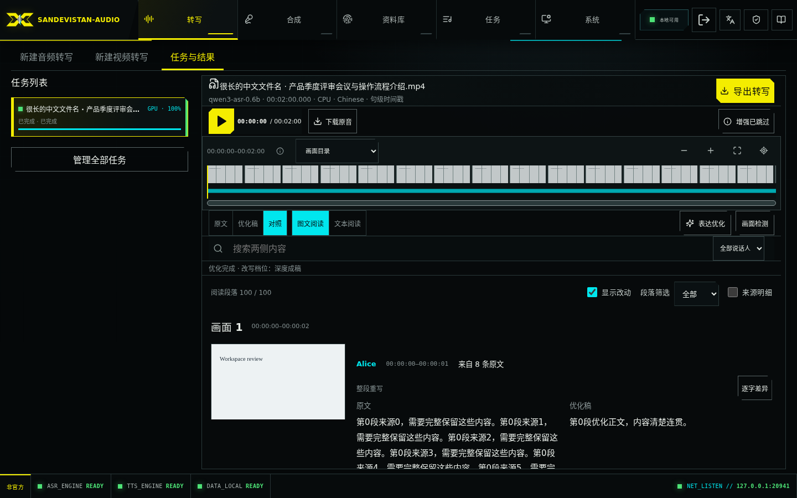

# 表达优化 / Expression optimization

在「系统状态 → 表达优化」配置 Ollama URL，获取模型、选择、验证、保存并启用；选择模型不会自动验证，未保存修改不改变当前生效配置。默认关闭，不会自动处理或发送历史转写。核心语音推理仍在本机运行；表达优化将本批来源正文、候选及任务提交时的热词发送到用户指定的 Ollama，不发送音视频，不提供隐式云端回退。非回环地址显示发送提醒；localhost 指服务端所在机器。

在设置中填写「请求上下文窗口（tokens）」：新连接默认 16384，最低 16K，例如 32768 为 32K、65536 为 64K；已有配置保留原值。窗口包含输入和输出，不能超过模型原生上限。每次调用显式发送该窗口，因此会覆盖 Ollama 的 `OLLAMA_CONTEXT_LENGTH` 默认值；该环境变量不是强制上限，设置较小窗口可控制本功能的资源预算。

验证先按所选窗口加载模型，再使用合成文本检查生成能力与实际分配。分配不足、无法确认或内存不足时验证失败，不自动缩小或扩大请求窗口。连接详情分别显示最近验证实际窗口、验证时间及模型原生上限；它们不是实时运行状态。旧记录没有实测值时显示「未记录」，需要重新验证。修改地址、代理、模型或请求窗口使旧验证失效，重新验证后才能保存启用；也可先关闭功能、保存尚未验证的配置。

正文分块、生成、接缝和事实复核使用同一个请求窗口，预留输出空间，关闭 thinking，输出上限保持4096 tokens，禁止输入静默截断。主流程执行／恢复时按快照窗口加载并核验，每次模型响应在写入检查点前再次核验；此阶段窗口不足、无法确认或明确的容量错误会暂停任务并保留进度，不降级成基础整理或「复核不可用」后发布。普通复核连接或格式异常仍遵循有界处理。小结 v2 沿用同一连接、模型与请求窗口快照，单次输出上限1024 tokens；小结阶段的窗口／容量故障可改用程序摘取，见下方自动兜底说明。远端服务类型、模型和硬件会影响速度及质量。

全局窗口修改仅影响新任务，旧任务恢复继续使用原快照。需要降低旧任务窗口重跑时，使用「删除优化数据」再重新生成；该删除会清理该任务的已发布稿、候选和进度，原始转写及媒体保留，不会局部改写旧快照。

## 连续语句成稿

对已完成的普通音频或视频任务选择「表达优化」。按同一人连续发言整理，另一人的插话、超过 15 秒的停顿和画面边界形成新段。阅读段落目标约 240 字、最多 400 字；一幅画面可有多段。仅在有可靠字词对齐时拆分跨画面来源，否则完整片段归属最大重叠画面，不猜测时间。不会根据同名猜测说话人，也不会改变原始转写、字幕或音频时间轴。

| 档位 | API 值 | 效果 |
| --- | --- | --- |
| 自然润色 | `polish` | 清理重复、口头冗余和病句，保留交流语气。 |
| 流畅重写 | `rewrite` | 默认档位，重组句式和表达顺序，形成连贯的对谈稿。 |
| 深度成稿 | `editorial` | 更充分地整理为书面稿，保留事实与有效细节，不生成摘要。 |

三个档位都支持多条来源合并。模型接收本批所属的来源片段，借助任务热词修正明确的听写错误；不向生成请求提供相邻批次或其他人的正文，避免将邻文误当作当前内容。不把当前热词库的后续修改写回历史任务。有语义但不确定的局部词语保留，没有完整语义的截断尾片可省略，原始来源始终可对照；不能凭猜测补全事实、原因、时间或人物关系。原本清晰的短句可以不改；文字变化比例不是质量评分。

长来源组按实际预算分成持久化子批次，目标约 90 字、最多 160 字，优先完整句子，其次逗号边界；预算紧张时进一步缩小。一个批次仍可包含多条原始来源，最终按原顺序组成同一组成稿，不再次整体摘要。真正无自然边界的强制拆分进行有界接缝整理，版本号和小数中的点不作为句界。暂停恢复复用已保存的批次与结果，不重写完成部分或重复拼接。

生成正文通常只请求一次；仅空输出、长度异常、重复残留或限定词丢失允许一次定向修复，附带上次候选和具体问题。新任务的正文子批次最多3次模型请求（传输重试包含在内），不叠加内外层重试额度；已有可用改写不会因后续尝试失败而撤销。仍无法得到正文时执行基础整理，并明确记录 `generation_method`，不冒充模型完成了改写。持续连接故障保存进度，恢复服务后可继续；无法安全保存时如实报告运行故障。

生成同时检查少量明确限定词的范围是否丢失（如“不止”“未必”“只能”，接受明确同义表达），必要时复用一次加强机会；不会把普通“不／不是”或合理自我纠正一概认作错误。这是有限保护，不能证明所有事实均正确。

## 统一完成与辅助检查

表达优化是一次完整操作：生成正文 → 自动检查 → 小结与标题生成及必要的自动兜底 → 发布。检查完成前本次新稿不能阅读或下载，原文始终可用；重新优化时，同一画面划分下的旧完成稿继续可用，直到新稿整体完成。检查只添加提示，不撤销或回滚正文。

事实复核明确区分 `pass`、`fact`、`uncertain`。通过结论可包含肯定性说明，不因说明非空而判为格式错误。事实疑点需定位原文和成稿证据，引用允许空白与全角字符规范化，不做模糊语义替换。新建任务只复核一次，不因事实疑点再次询问相同模型；仅连接或 JSON 异常允许有界重试。证据引用无法在原文中定位时记录为不确定并保留诊断，不伪造引用、不改判通过。旧任务继续沿用其配置快照。

复核结果只是辅助，不能保证绝对正确。疑点、不确定、不可用和基础整理在完成摘要中提供详情，不能将未能检查当作通过。每个子批次最多两次检查请求、每次最多 120 秒；连续三个子批次出现连接或超时故障后，剩余检查记为不可用，仍交付已生成正文。

qwen3.5:4b 与 9b 的本轮实测仍有事实改变、复核漏报和整理不足；完整范围及未达标项见[验证记录](EXPRESSION_OPTIMIZATION_VALIDATION.md)。来源破碎或听写错误较多时，不能将模型结论当作事实认证。

暂停／继续作用于整个流程，恢复复用已保存的正文和检查点，无需单独发起复核。API 重启后未完成工作暂停，用户可继续；关闭功能也暂停未完成工作。删除优化或父任务取消相关请求并清理正文、子批次、检查记录和导出缓存。旧响应不能覆盖新稿或恢复已删除的数据。提示统计可能重叠，不应相加作为总段数。

## 阅读、对照和导出

原文保留原始片段，优化稿按阅读段落显示，对照完整显示每段原文和优化稿。桌面两侧并排，手机上下排列，共用正文滚动区；无需逐段展开原文。来源 ID、时间戳等通过全局「来源明细」开关查看。默认显示改动，大幅改写使用整段提示，可选择详细差异。

「原文／优化稿／对照」和「图文阅读／文本阅读」是两组独立选项，表达优化、画面检测和音频增强入口位置固定。三个版本保留同一时间轴，定位对应画面或阅读段落。搜索覆盖当前版本可见正文、小结及画面标题，对照也搜索两侧正文，提供高亮、前后命中跳转和清除筛选。统计区分原文片段、阅读段落和命中数，不把内部子批次当作阅读段落。

图文模式每幅画面左图右文，对照的右侧为两栏正文。正式应用新检测参数／画面划分或编辑边界，会在同一事务内清理旧优化数据并回到原文，之后可手动重新优化。仅编辑参数、预览、更换截图、改变导出隐藏状态或人物显示名不会清理成稿；应用失败保留旧划分和旧稿。

统一「导出转写」入口长期记忆内容、各内容格式、脱敏及替换规则；不可用选择临时回退，不覆盖偏好。弹窗说明将下载的版本和格式，可选择使用当前阅读版本；重新生成期间导出旧完成稿会明确提示。下载成功触发浏览器下载后关闭弹窗，失败保留选项。优化稿支持 PDF/DOCX/TXT，对照支持横向双栏 PDF/DOCX。段落和来源覆盖与页面一致，具体疑点保留标记，对照附脱敏原因。来源、正文和原因使用相同替换策略，导出不修改持久化原始文件。

## API 与脚本

所有接口沿用服务的 Bearer／浏览器会话认证。下列路径前缀为 `/api/v1`；字段详见本地 `/docs` 与 `/openapi.json`。

验证与保存请求接受整数 `context_length`（最低 16384）。省略时沿用匹配验证凭证或同一连接的已保存窗口，新连接默认 16384。响应中的 `context_length` 为请求预算、`observed_context_length` 为 `verified_at` 时的实测分配、`model_context_length` 为模型原生上限；旧记录的实测值为 null。可执行的验证、保存示例见本地 `/docs`「上下文配置示例」。

| 方法与路径 | 用途 |
| --- | --- |
| GET/PUT `/settings/transcript-optimization` | 读取、保存配置 |
| POST `/settings/transcript-optimization/discover` | 获取模型 |
| POST `/settings/transcript-optimization/verify` | 内置合成样本验证，返回短期 verification_token |
| GET/POST `/jobs/{id}/transcript-optimization` | 状态／创建；GET 支持 ETag |
| POST `/jobs/{id}/transcript-optimization/pause`、`/resume` | `{run_id,phase:"workflow"}`；兼容旧 phase 值，均控制整个未完成流程 |
| GET `/jobs/{id}/transcript-optimization/result?run_id=...` | 正文、来源及复核详情 |
| DELETE `/jobs/{id}/transcript-optimization?purge=true` | 删除全部优化数据 |
| POST `/jobs/{id}/transcript-export` | 使用 text_version、optimization_id 导出 |

创建需 `Idempotency-Key`，正文为 `{regenerate:false,rewrite_mode:"rewrite"}`。首次 202、同请求重放 200、冲突 409、容量不足 429（Retry-After）；更换档位须重新生成，恢复沿用配置快照。原有限制和父任务校验继续适用。

结果 `complete`、`published` 和 `succeeded` 都表示正文生成、检查及首轮小结恢复流程已结束，具有可阅读和导出的成稿；小结是否全部有效交付需读取 `summary_status.counts`。摘要 `phase` 为 generation/review/summaries/complete，`reviewed_parts/total_parts` 表示实际保存的检查进度；疑点和不可用数量独立保留。未发布结果请求返回 409。全局任务列表和 SSE 仍只含摘要，不读取正文统计。

段落 `text` 是 v7 实际成稿；`sources`、`segment_ids` 保留不可变来源，`scene_ids` 最多包含一个归属画面，`merged_source_count` 为来源数。`generation_method` 区分 model/basic_cleanup/mixed；`review_outcome` 区分 pending/pass/fact/uncertain/unavailable。兼容字段 `review_status` 仅 pass 对应 accepted、fact 对应 needs_review，其余为 null；历史 null 不表示通过。旧策略的 candidate_text 保持兼容读取。

```bash
python3 scripts/optimize_transcript.py --url http://localhost:20815 --job JOB_ID --rewrite-mode editorial
python3 scripts/optimize_transcript.py --url http://localhost:20815 --job JOB_ID --resume
```

URL 应使用实际部署地址。客户端密钥通过 `AUDIO_INTEL_API_KEY` 提供，不写入 URL。默认等待整个流程完成后输出 JSON；旧 `--wait-review` 参数仅为命令兼容保留。

## 持久化与升级

历史迁移说明：策略 v7／SQLite v19 增加统一阶段和检查进度。v18 及更早版本升级至 v19 时，一次性清理旧音频和视频优化正文、候选及检查记录，用户需手动重新优化；v19→v20 和 v20→v21 增量迁移保留已有数据及检查点（见下方分组小结说明）。原始转写、媒体、人物、热词快照和模型配置保留。升级前做 SQLite 一致性备份，无需复制历史媒体；遵循[升级指南](UPGRADE.md)恢复服务并验收后清理临时备份。

档位与导出偏好继续长期保存，刷新、重开、退出登录和资料库替换后保留。阅读方式、搜索、位置、差异显示及新增来源明细开关属于当前任务浏览器会话，刷新保留、退出登录清理，最多保留 200 个任务，不存正文或密钥。差异显示默认开启，已有明确关闭的偏好继续尊重。

English: Policy v7 scopes bounded reading paragraphs to one scene and one consecutive speaker turn. Generation and bounded annotation-only checks form one workflow; only its completed draft can be read or exported. A previous published draft stays available during regeneration. Comparison shows complete source and draft prose; source metadata is optional. Applying scene boundaries invalidates old drafts transactionally. The historical v18-and-earlier→v19 migration clears pre-v19 optimization data once, while preserving original jobs, media and model settings. The additive v19→v20 and v20→v21 migrations preserve existing drafts, candidates and insight checkpoints. Take a SQLite-only backup, restore the recorded deployment and verify it before removing the backup.

## 开发质量验证

固定合成／去标识化语料在 `tests/fixtures/optimization_quality.json`。`scripts/evaluate_optimization.py` 直接调用所选服务，不创建应用任务；必须显式指定服务和模型。先验证语料，再串行执行两个模型，避免竞争资源：

```bash
.runtime/api/bin/python scripts/evaluate_optimization.py --validate-corpus
.runtime/api/bin/python scripts/evaluate_optimization.py --base-url http://localhost:11434 --model qwen3.5:4b --output tmp/quality-4b.json --repeats 3
.runtime/api/bin/python scripts/evaluate_optimization.py --base-url http://localhost:11434 --model qwen3.5:9b --output tmp/quality-9b.json --repeats 3
.runtime/api/bin/python scripts/evaluate_optimization.py --base-url http://localhost:11434 --model qwen3.5:4b --corpus tests/fixtures/optimization_quality_long.json --output tmp/quality-long-4b.json --repeats 1
```

Windows 使用 API 环境的对应 Python 路径。工具保存服务版本、模型 digest、策略及语料校验和、逐项输出和耗时；`--resume` 只恢复身份一致的结果。复核用预置候选独立测量，未知／不可用不从分母删除。语言改善和事实保留须对记录逐项独立审读，不能由改字比例自动认证。真实任务评测应复制到隔离测试目录，按来源范围比较并统计来源字数加权结果，不能修改用户任务来做测试。

## 界面示例与复现 / Interface examples

以下为合成测试内容，用于展示界面，不是模型质量证据。



[手机对照 / Mobile comparison](assets/optimization/comparison-390.png)

在隔离 mock 服务运行 `optimization-workflow.spec.ts` 和 `video-enrollment.spec.ts` 后，执行 `python3 scripts/collect_optimization_doc_assets.py` 收集截图。README 使用 `scripts/capture_readme_assets.mjs`，需设置 `AUDIO_INTEL_CAPTURE_BASE_URL` 为隔离服务地址，不能对正常部署创建演示任务。两个脚本仅使用合成任务；测试检查交互、控制台错误及桌面／390 px 横向溢出。

English: These synthetic fixtures demonstrate layout, not model quality. Run both named Playwright files together against an isolated mock service, then collect screenshots. README capture also requires an isolated mock service and must never seed the normal deployment.


## 分组小结与画面标题

新建表达优化任务默认在正文改写、复核之后提炼小结，完成一轮尝试才交付新稿。每组小结提炼 TOP1 观点、原文明示的支持理由、关键数字或期限；存在另一个独立重要观点时可以增加第二句。保持原文语言，中文等连续书写每句不超过50字，英文等分词书写不超过30词，混合语种按两种预算比例合计；标题分别不超过20字／10词。不为了补足要素编造理由、因果、主体或数字，只有整段为空、标点、口头填充或纯问候致谢才不生成小结；目录、介绍、引用说明、操作过程和含义不确定的内容仍算有效输入。

视频在现有画面边界内生成分组小结，再根据该画面的全部归属文本提炼一个标题。长画面逐层归纳，中间结果持久化；不会只截取开头。分组和原始时间轴保持原样。

小结显示在优化稿／对照版每组正文下面，对照时横跨两列，避免与任一侧正文混淆。视频图文阅读和文本阅读都有画面标题；画面目录追加标题，原文模式也可用目录标题。可搜索当前可见的小结和标题，命中计数、跳转与高亮一致。PDF/Word 优化稿及对照版包含小结和标题，并应用同一套关键词替换。原文导出、TXT 和字幕保持原格式。

小结策略 v2 在本次执行内自动恢复：先用独立的小结／标题提示生成一次，仅在格式、长度、数字或明确范围异常时定向修复一次，随后最多请求一次原文关键词提取。每项（长画面的每个归纳节点）总计最多3次模型请求，包含连接重试，最长60秒；第二句缺失或无效不阻塞合格的第一句。没有额外的模型语义复核循环，本地检查只是有限保护，并非事实认证。连续3次服务故障会跳过后续模型请求，仍为有内容的项选取原文短句／主题词；上下文或容量故障同样使用原文兜底。长画面仍处理全部来源并复用中间检查点。

关键词按完整原文短语去重、择取至长度合规，不因拼接过长就丢弃全部结果，也不截断数字及单位。只要存在通过来源与长度检查的可用关键词，就立即采用，标记为“关键词”，该项结束，不再执行原文兜底。模型关键词与原文兜底都记为 `ready`，分别标注“关键词”“原文要点”；页面、PDF/Word 使用同一标记和替换规则，状态中分开显示数量。`not_applicable` 仅用于确实无实质内容；无法保存、来源失效等真实运行故障不伪装成成功。

最终“原文要点”由程序规则摘取，不再调用模型：优先选取长度合适的原文子句，倾向含要求、预算、理由等信息的句子；没有合适子句时，再选择短语或长度受限的片段。不会默认复制整组全文，短分组可能恰好全部入选。中文小结50字、标题20字及其他语种预算仍有效。长画面处理全部来源后逐层归纳；最终兜底可能从已保存的分片归纳结果中摘取，不能将其一概理解为逐字引用原始转写。

只在新建或重新优化时启用 v2；旧 v1 优化稿仍可阅读、导出及显式补试，保留其原策略。用户主动暂停及服务重启后继续保持暂停，需要显式继续；本次执行内的自动兜底不等于后台无限重启任务。已发布稿的“补试未生成小结”仍作为暂停／遗留缺项的恢复入口，保留正文和成功项，使用原模型、地址、代理、上下文、模型摘要和来源快照，不切换模型。模型或来源变化返回409。

SQLite v20→v21 只增加生成方式、尝试次数、质量提示和有界尝试记录，保留 v20 数据；v19→v20 的旧迁移同样保留已有任务及优化稿。每项最多保留12条尝试诊断，失败原因不会因显式补试清空；全局列表／SSE 只读计数，不载入候选或来源文本。升级前备份 SQLite 即可，无媒体迁移。小结版本独立于正文提示策略 v7。浏览器偏好及阅读草稿的存储期限不变。

| 接口（前缀 `/api/v1`） | 行为 |
| --- | --- |
| GET `/jobs/{id}/transcript-optimization/summaries?run_id=...` | 轻量小结数据，支持 ETag；包含 `summary_status`、按分组 ordinal 索引的 `groups` 与按画面 ID 索引的 `scenes` |
| POST `/jobs/{id}/transcript-optimization/summaries/retry` | `{run_id}`，必须带 `Idempotency-Key`；首次入队202、重放或无工作200、冲突409、队列／磁盘不足429（带 Retry-After） |
| POST `/jobs/{id}/transcript-optimization/summaries/pause` | `{run_id}`，只暂停已发布稿的小结补试；未发布稿使用原工作流暂停接口 |

状态和能力发现仅增加小结版本、阶段、进度及计数，全局任务列表／SSE 不含小结文本，也不读取完整结果。结果增加 `group_summary`、画面的 `title_summary`、顶层 `summary_status`。`ready` 表示有内容，`not_applicable` 表示无可提炼内容，`unavailable` 表示未能生成。小结整体状态为 pending/queued/running/paused/partial/completed；旧稿为 not_requested。


v2 单项可选元数据：`generation_method` 为 `model`、`model_repair`、`model_keywords`、`source_excerpt`；`attempt_count` 为已完成的模型请求数（长画面包含各节点）；`quality_notice` 为 `keywords`／`source_excerpt` 或 null；`skip_reason` 仅在无实质内容时为 `no_substantive_content`。计数增加 `model_ready`、`repaired_ready`、`keyword_ready`、`extractive_ready` 和后两者之和 `fallback_ready`；历史未知生成方式不推算为任何类别。有效交付率分别按小结、画面标题计算：`ready / (total - skipped)`，并同时报告各生成方式。分母为0时记为不适用，不宣称100%成功。`processed = ready + skipped + failed`，`fallback_ready = keyword_ready + extractive_ready`；v2 的四种已知生成方式之和为 `ready`，历史未知方式不能套用该分类等式。

English: V2 generates once, repairs only explicit abnormalities once, then attempts literal keyword extraction. All transport retries share the same three-request / 60-second node budget. Accepted, source-matched keywords end the item immediately. Otherwise local rules select a bounded clause, phrase or excerpt, rather than copying the whole group by default. For reduced long scenes the selected text may come from saved intermediate notes. A short group can fit in full. All fallback output shares the length limits. A zero eligible denominator means no applicable delivery rate. Keywords and excerpts count as ready and are labelled in the reader and PDF/Word exports, with separate counters. Only genuinely empty/greeting inputs are excluded; outlines, introductions and procedures remain eligible. There is no auxiliary semantic-review voting loop or autonomous restart after a pause/reboot. Existing v1 runs retain their saved policy. SQLite v20→v21 is additive and requires a SQLite-only backup.
