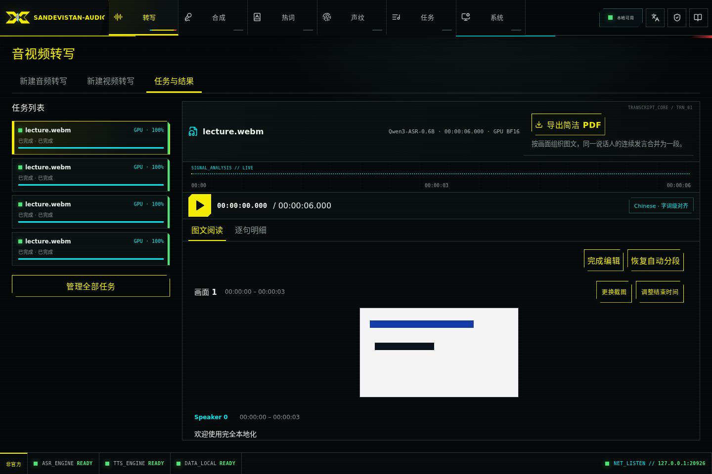
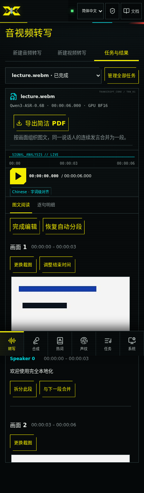

# 音视频转写 / Audio and video transcription

工作台分为「新建音频转写」「新建视频转写」「任务与结果」。音频与视频共用 ASR 队列，使用相同的模型、设备、热词和说话人能力。视频入口额外提供 PPT 区域框选和画面分析。

The workspace has separate audio/video creation tabs and a shared task/result tab. Both use the same ASR queue, models, devices, hotwords and speaker features. Video adds slide-region selection and presentation analysis.

## 上传 / Uploads

- 音频 / Audio: WAV, MP3, FLAC, M4A, AAC, OGG, OPUS, AIFF; 默认 / default **4 GiB** (`AUDIO_INTEL_MAX_UPLOAD_BYTES`).
- 视频 / Video: MP4, M4V, MOV, MKV, WEBM, AVI, MPEG, MPG, TS; 默认 / default **25 GiB = 26,843,545,600 bytes** (`AUDIO_INTEL_MAX_VIDEO_UPLOAD_BYTES`).容器必须有可解码的画面和音轨 / A decodable video track and audio track are required.
- 实际限制以 `GET /api/v1/capabilities` 的 `limits.max_upload_bytes` 和 `asr.video` 为准；容器扩展名不保证其中所有编解码器都可用。原音频 API 保持对音视频输入的兼容和原有上限；获得画面分析与 25 GiB 上限须使用视频 API。

Capabilities are authoritative; a container extension does not guarantee every codec within it is supported. The original audio API keeps its audio/video input compatibility and original limit. Use the new video API for presentation analysis and the 25 GiB limit.

视频采用顺序 32 MiB 分片，末片为剩余字节。暂停、断网或服务重启后，重新选择同一文件即可继续；浏览器重新计算已确认部分的 SHA-256，防止误接另一个文件。未完成上传最多 8 个，按剩余字节预留磁盘额度；保留磁盘安全水位。上传完成后才占用队列位置，队列满时可稍后再次提交。

Video uses sequential 32 MiB chunks, with a smaller final remainder. After pause, network loss or server restart, reselect the same file; confirmed chunks are verified against SHA-256 hashes before resuming. Up to eight unfinished uploads reserve their remaining bytes against disk admission. A completed upload takes a queue slot only when submitted; retry submission if the queue is full.

未完成上传闲置 **24 小时**或创建满 **7 天**后到期，每 15 分钟清理一次；「清理未完成上传」立即删除服务端残留。浏览器仅在 **sessionStorage** 保存上传 ID、幂等键、文件名/大小和提交设置，不保存文件内容；刷新保留，关闭页签或退出登录后清除浏览器记录，服务端仍按到期策略清理。已提交任务由普通任务删除机制管理。多页签不要同时续传同一上传。

Unfinished uploads expire after **24 idle hours** or **7 days from creation**, and are swept every 15 minutes. Explicit discard removes received bytes immediately. Browser **sessionStorage** holds only IDs, idempotency keys, filename/size and settings, never file bytes: reload preserves it; closing the tab or logging out clears the browser journal. Server expiry still applies. Submitted inputs belong to ordinary tasks. Avoid resuming one upload from multiple tabs simultaneously.

## 画面与讨论 / Images and discussion

面向 PPT 讲解、屏幕录制。使用 PyAV 内置的 FFmpeg `scdet`，按约 0.5 秒抽样，在内存中比较感知哈希、文字边缘保留率和稳定性；同一页逐步显示内容尽量合并，保留最后的稳定完整画面。非相邻的重复页面保留各自时间范围。默认最多 2,000 段，超过时明确失败并提示拆分源文件。这里的「关键帧」指内容代表画面，不是视频编码的 I 帧。

Designed for slides and screen recordings. PyAV's FFmpeg `scdet` is complemented by in-memory perceptual hashes, edge retention and stability checks sampled about every 0.5 seconds. Incremental slide builds are merged where possible, retaining the last stable frame. Nonadjacent repeated pages retain separate time ranges. More than 2,000 sections fails explicitly with a request to split the source. These are content representatives, not codec I-frames.

视频时刻依据媒体 PTS，与音轨共用起点；音轨延迟以静音补齐，不按帧序号推算时间。跨页发言有完整可靠的逐词对齐时按词分配，否则整句归属时间重叠最多的一页，保持原文、不丢句。画面分析是启发式算法，不做 OCR 或语义理解；短于抽样/稳定窗口的页面、相似模板、复杂动画、镜头移动可能需要修正。带讲者小窗时可先框选 PPT 区域。

Media PTS provides a shared audio/video origin; delayed audio is padded with silence. Speech crossing a page boundary is split at aligned words only when alignment covers the original text; otherwise the whole sentence goes to the page with greatest time overlap. No text is dropped. Detection is heuristic, without OCR or semantic understanding. Very short pages, similar templates, complex animation or camera movement may need correction. Crop to the slide region when a speaker inset interferes.

结果支持与下一段合并、拆分、调整结束时间、更换截图和恢复自动分段。修订号避免覆盖其他客户端的修改；遇到冲突，关闭编辑器并重新加载分段。原始逐句文本与说话人快照保持可查看。

Results support merge-next, split, boundary adjustment, replacement images and restoration of automatic sections. Revision checks prevent overwriting another client's edits; on conflict, close the editor and reload sections. Original detailed text and speaker snapshots remain accessible.

## 音频增强 / Audio enhancement

网页使用一个“音频增强”总开关。视频 API 推荐在 `/api/v1/asr/video-jobs` JSON 中使用
`audio_enhancement=auto|off`，
新任务默认 `auto`。上传与断点校验不处理媒体；增强在现有 ASR 任务的 CPU 子阶段运行，
保留采样数、视频时间原点和说话人识别的原音输入。默认回放原音，实际增强后可切换或
下载独立增强音。旧版上传恢复原设置，历史任务不补生成。详见[人声增强](ASR_ENHANCEMENT.md)。

The browser uses one Audio enhancement checkbox. Video JSON recommends
`audio_enhancement=auto|off`, defaulting to `auto`. Independent booleans remain
supported for compatibility and cannot be mixed with the combined control (422). Upload/resume
verification does not process media. The existing ASR task enhances on CPU while
preserving sample count, video time origin and original audio for diarization.
Applied results offer an enhanced track; original playback remains the default.
Paused uploads retain their saved settings, including independent combinations;
pre-enhancement uploads stay off. Historical jobs are not backfilled. Denoising
and gain report their outcomes separately; partial success can still provide an
enhanced track. See the [enhancement contract](ASR_ENHANCEMENT.md).

独立布尔参数继续兼容 API 调用，但不能与总开关混用（422）。暂停上传保留原参数，
包括旧的独立组合；缺少增强字段的旧上传仍按关闭处理。降噪失败不阻断增益，是否生效
以结果中两项的实际状态为准。

原音／增强音控件将“试听”分段选择与“下载原音／下载增强音”分组，手机上两组分行。
下载原音提供播放器中未增强的 WAV（视频任务同样下载音轨 WAV），不改变试听音轨或进度。
没有增强音时仅提供原音下载；历史任务未保留原音 WAV 时显示不可用，不自动补生成。

Original/enhanced track selection is grouped separately from the two downloads; mobile uses two rows.
Original download serves the saved unenhanced playback WAV, including the audio track of video jobs,
without changing listening state. Jobs without enhanced audio offer only original download;
historical jobs without a saved original WAV show an unavailable explanation and are not backfilled.

## PDF 与磁盘 / PDF and disk use

音频提供主操作「导出简洁 PDF」，次级「明细与字幕」保留 JSON、TXT、SRT、VTT。简洁 PDF 将相同 speaker ID 的相邻发言合并为一段，保留第一句开始与最后一句结束时间，不删改口头语、不做总结；同名但不同 ID 的说话人不会误合并。视频也支持 JSON、TXT、SRT、VTT，并提供图文简洁 PDF，按画面分段，画面下展示相应讨论。PDF 内嵌本地简体中文字体，无云服务或系统字体依赖。

Audio offers a primary concise PDF action and a secondary details/subtitles menu. Adjacent speech with the same speaker ID merges with its combined time range; words and disfluencies are preserved. Equal names with different IDs do not merge. Video offers illustrated concise PDF, with images followed by their discussion. A bundled Chinese font keeps PDF rendering offline.

上传直接顺序追加到一份文件，校验并 fsync 后才确认偏移；不创建分片文件再拼接、不预分配 25 GiB，不在重试时重写已确认数据。提交时同盘重命名。画面分析只保存最终代表 JPEG，不保存抽样帧序列。原音复用一份归一化 WAV；实际应用人声增强时另存一份增强 WAV，约每小时 115 MB，旁路时不增加；临时目录和数据目录在同一文件系统时完成阶段直接移动，否则跨盘移动需一次复制。失败/取消后的工作目录由现有 worker 清理。PDF 按需在内存生成，单渲染并发、64 MiB LRU 缓存（5 分钟）；单份 PDF 输入上限为 400 万文本字符、128 MiB JPEG，超过返回 413 并提示拆分。预览最多两个解码器且不写磁盘。修改截图后清理不再被当前/原始分段引用的图片，删除任务清理其输入与结果。

Uploads append to one file and are acknowledged only after checksum verification and fsync: no chunk concatenation, full-size preallocation or acknowledged-byte rewrite. Submission renames on the same filesystem. Only final JPEG representatives are written; sampled frames stay in memory. One normalized WAV preserves original playback; applied enhancement retains a separate WAV (about 115 MB/hour), while bypass adds no file. Keep temporary and data directories on the same filesystem for rename-only completion; crossing filesystems requires one copy. Existing worker cleanup removes failed/cancelled working directories. PDFs render on demand in memory, with one renderer and a 64 MiB, five-minute LRU. PDF inputs are limited to 4 million text characters and 128 MiB of JPEGs; larger exports return 413 with a split-source hint. At most two preview decoders run, without writing images. Unreferenced edited images are removed, and task deletion removes owned inputs/results.

算法选择参考：[FFmpeg scdet](https://ffmpeg.org/ffmpeg-filters.html#scdet)、[PySceneDetect 检测器](https://www.scenedetect.com/docs/api/detectors.html)。后者提供内容/自适应切镜，但不直接判断 PPT 的同页动画，因此本实现复用现有 FFmpeg，加上面向幻灯片的比较，避免增加 OpenCV/模型运行时。

## 客户端示例 / Client example

```bash
AUDIO_INTEL_BASE_URL=http://127.0.0.1:20810 \
  .runtime/api/bin/python scripts/submit_video.py lecture.mp4 --state tmp/lecture-upload.json --pdf tmp/lecture.pdf
```

Windows 使用 `.runtime\api\Scripts\python.exe`。可选 `--device cpu` / `--device gpu`；省略则采用部署默认。鉴权从 `AUDIO_INTEL_API_KEY` 读取。中断后使用同一 `--state` 和原文件重跑；收到 429 时按 `Retry-After` 等待后重跑。上传过期后使用新的状态文件。完整接口见 [API 文档](API.md) 与本地 `/docs`。

On Windows use `.runtime\api\Scripts\python.exe`. Optional `--device` overrides the deployment default. Authentication comes from `AUDIO_INTEL_API_KEY`. Rerun with the same state and file after interruption; on 429, wait for `Retry-After` before rerunning. Use a new journal after expiry. See [API documentation](API.md) and local `/docs`.

## 界面示例 / Interface examples

以下使用两页合成测试视频与 mock 转写内容，展示图文阅读与编辑控件；不是实际会议数据。 / These screenshots use a two-slide synthetic test video and mock transcript, not a real meeting.


## 恢复与编辑状态 / Recovery and editing state

续传先显示“正在校验已上传内容”：分母是服务端已确认的字节数，分子是本次已校验的字节数；通过后切换到整份文件的上传进度，从确认偏移继续。两种百分比分别表示本地校验与网络传输，均不是推理进度；校验和传输均可暂停。

Resume first verifies local bytes against the server manifest. Verification percentages use confirmed bytes as their total; upload percentages use the whole file and resume at the confirmed offset. Both stages can be paused and neither represents inference progress.

图文阅读默认隐藏分段修改按钮，点击“编辑分段”后可修改，点击“完成编辑”回到阅读。弹窗固定打开时的 revision 与时间范围；后台修订变化或保存返回 409 时保留输入、禁用保存。点击“放弃本次编辑并重新加载”明确丢弃未保存输入，读取最新分段后再编辑，不自动覆盖其他客户端。

Reading mode hides section edits. Choose Edit sections to modify them, then Finish editing to return. Dialogs retain their opening revision and time range. Background revision changes or HTTP 409 preserve the draft and disable saving; Discard this edit and reload explicitly drops the draft before loading current sections. No automatic replay overwrites another client's changes.

PDF 下载通过一次 POST 接收完整内容后保存。429 按 Retry-After 等待后手动重试，413 表示超出导出上限，应拆分源文件重新转写；音频还可下载明细与字幕。401 重新登录后再导出，断网直接重试导出，无需重新转写。

PDF uses a single POST and saves after the full response arrives. For 429, wait for Retry-After then export manually; for 413, split the source and transcribe smaller files, or use audio detail/subtitle exports. Sign in again after 401. Retry an interrupted download without submitting a new transcription.

命令行 `--pdf` 期间续传文件还保存已接受的 `job_id`，直到 PDF 完整写入临时文件、关闭并原子替换目标文件后才清除。轮询中断、下载失败、任务失败或取消均保留记录，重跑只查询原任务；确需新任务时使用新的 `--state`。已有完整 PDF 不会被失败下载破坏。省略 `--pdf` 时，提交成功即清除记录。旧记录可继续使用；恢复时沿用记录中的转写设置。

With CLI `--pdf`, the journal retains the accepted `job_id` until the download is fully written, closed and atomically replaces the destination. Interrupted polling/downloads and failed/cancelled jobs retain the journal; rerunning reads the same job. Use a new `--state` for an intentional new job. Failed downloads preserve existing complete PDFs. Without `--pdf`, successful submission clears the journal. Legacy journals remain readable and saved transcription parameters are retained on resume.

编辑模式 / Editing mode:





## 从视频加入声纹库 / Add video speech to the voiceprint library

在「图文阅读」中点击说话人旁的「加入声纹库」，即可试听并勾选该人在整个任务中的原始语句，然后选择已有人员或新建人员。默认预选点击段落所包含、尚未入库的原始语句；每条语句单独保存为一个样本，跨画面重复显示的语句不会重复列出。已入库语句不可再次选择。声纹库加载失败可重试，提交失败保留输入。也可继续使用「逐句明细」中的勾选入库入口。

样本使用与转写和播放相同时间轴的音频，包含视频起始偏移和延迟音轨处理；缺少任务保存的播放音频时明确报错，不自动重建历史文件。关闭弹窗会停止试听，选择仅在当前弹窗内保留。

图文阅读每批展示 20 个画面，接近底部时自动追加；「加载更多」按钮仍可手动使用。逐句明细继续按每批 40 条加载。

English: In **Illustrated reading**, choose **Add to voiceprint library** beside a speaker. Preview and select original sentences across the task, then choose an existing person or create one. The clicked paragraph’s original sentences are preselected, excluding previously imported ones; each sentence becomes one sample, and repeated scene references appear only once. Previously imported sentences are disabled. Library loading and submission errors support retry. The existing selection flow in **Segment details** remains available. Video samples use the saved playback audio on the transcription timeline, including media offsets and delayed audio; missing playback is reported without rebuilding historical files. Closing the dialog stops preview and clears its temporary selection. Scenes load automatically in batches of 20 near the bottom, with a manual **Load more** fallback; segment details retain batches of 40.

| 桌面语句选择 / Desktop selection | 390 px 语句选择 / Mobile selection |
| --- | --- |
|  |  |

截图使用合成测试数据 / Screenshots use synthetic test data.

## 分组与脱敏导出 / Groups and redacted export

音视频任务均可选择多个声纹分组，默认全部，提交时固定人员 ID。PDF、JSON、TXT、SRT、VTT 下载默认脱敏，可关闭；只处理下载副本，原始结果、音频和截图不改写。关键词每行 `原词=替换词`，最多 100 对，浏览器长期记忆开关和规则。具体算法、边界和接口见 [API 指南](API.md#on-demand-redacted-transcript-export--按需脱敏导出)。

CLI 的 `--voiceprint-group ID` 可重复选择分组，省略使用全部；`--pdf` 默认脱敏，`--no-redact` 导出原文，`--replacements rules.json` 接收 UTF-8 `{source,target}` 数组。中断后沿用原续传记录和已接受任务，不重新计算任务范围；导出选项在下载时应用。

English: Select voiceprint groups for audio/video; eligible people are fixed at acceptance. All transcript formats default to redacted downloads, preserving original results/audio/images. CLI `--voiceprint-group ID` repeats, `--pdf` redacts by default, `--no-redact` exports raw, and `--replacements` reads a UTF-8 JSON array. Export options are applied at download time; resumed accepted jobs keep their scope.

## 阅读连续性与时间输入 / Reading continuity and time input

图文阅读和逐句明细分别记住当前任务的位置与已加载数量，刷新页面也可继续阅读；逐句搜索和说话人筛选一并恢复。编辑、合并、拆分后以分段 ID 和时间恢复附近位置。刷新期间保留旧内容并显示状态，修改按钮暂时禁用；失败时可重试。记录只在当前页签 sessionStorage 保存，退出登录或鉴权失效清除，详见[工作台指南](WORKSPACES.md)。

更换截图、拆分和调整结束时间支持秒数与 `hh:mm:ss.sss`，两者同步；提供 ±0.1 秒及“使用播放位置”。截图时刻允许等于分段起点，必须小于终点；拆分与边界必须严格在对应范围内。非法输入即时提示并禁用保存，服务端继续校验范围与修订号。

桌面保留 PDF 快捷按钮和“明细与字幕”菜单；窄屏使用“导出转写”弹窗统一选择 PDF/TXT/SRT/VTT/JSON、脱敏开关和替换规则。菜单支持点击外部或 Escape 关闭，不改变阅读滚动。规则错误即时显示；仅在脱敏开启时阻止下载，关闭开关可继续导出原文。声纹入库分两步，显示已选数量、固定操作区，回到上一步保留勾选。

English: Each task/view retains its reading anchor and loaded count across navigation/reload, including segment filters. Edited sections restore a nearby ID/time anchor. Refresh keeps old content visible, disables editing and provides retry on failure. Current-tab sessionStorage clears on logout/auth invalidation. Time fields accept synchronized seconds and hh:mm:ss.sss, with ±0.1 and current-playback controls. Invalid ranges disable Save; server validation remains authoritative. Narrow screens consolidate transcript formats/redaction/rules into one export dialog. Desktop menus dismiss on outside click/Escape. Invalid rules block downloads only when redaction is enabled. Enrollment preselects clicked-paragraph sentences, retains selections between its two steps and keeps footer actions reachable.

高级设置分别配置 `speech_enhancement_strength`（0–2，默认 1）与 `background_denoise_strength`（0–1，GTCRN 默认 0.5），视频提交 JSON 保存两项力度。Capabilities 公布实际范围／默认值；仅影响新提交任务，暂停上传保留原参数。Advanced strengths and reset share audio ASR preferences; paused uploads keep their saved snapshot.

## 视频结果时间轴 / Video result timeline

视频结果默认常显波形，上方为已有场景代表截图，共用同一时间刻度；波形是播放定位控件，不另设播放进度滑块。初始显示全片，可×2／÷2缩放、平移窗口（最小10秒，短视频以全长为限）、显示全片及回到播放位置。手动平移暂时关闭跟随播放；“浏览时间范围”只移动可见窗口，不改变播放位置。截图区间按实际起止时间成比例排列，密集场景可通过场景菜单和缩放定位。仅加载可见且有展示空间的缩略图，避免长视频一次请求全部图片。

悬停或键盘聚焦缩略图显示放大预览、场景范围和截图时刻，Escape／离开关闭；移动端可点击预览并跳转。点击场景定位到 `scene.start`，保留暂停／播放状态，并在当前图文阅读或逐句明细模式中显示对应内容；代表帧的 `frame_time` 可能位于场景末尾，不用作跳转时间。编辑场景后，阅读区与时间轴共用同一份修订结果并同时更新。

English: The always-visible waveform seeks playback; representative scene thumbnails share its time scale. Zoom/pan controls browse the window separately from seeking. Manual pan pauses auto-follow; Return to playhead restores it. Hover/focus previews reuse existing images, never decode additional video frames. Scene selection seeks the scene start, preserves playback state and reveals the relevant reading content. Both views use one revision-aware scenes resource. Peaks are requested for the visible saved audio window; playhead ticks do not refetch. No historical media rewrite or transcription/enhancement pipeline change is required.
