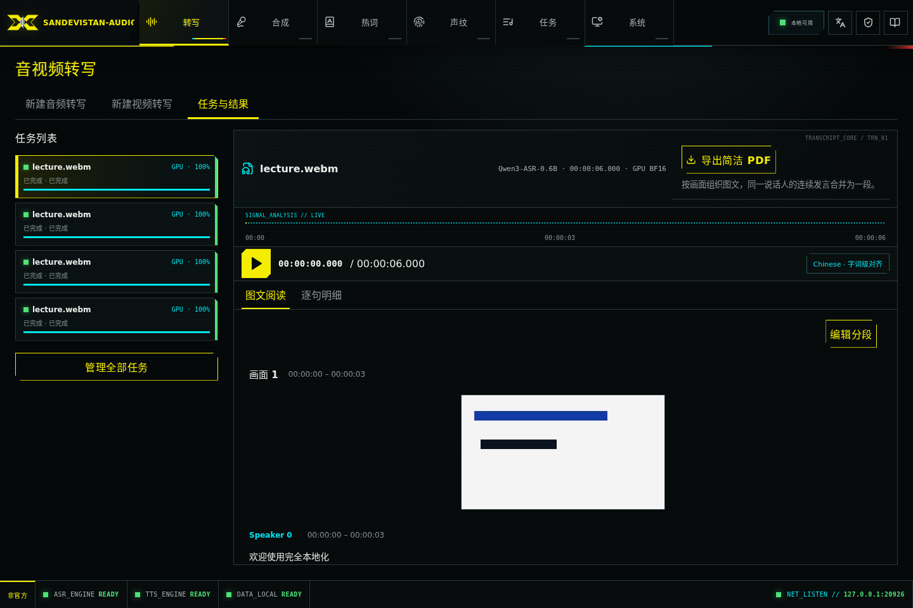
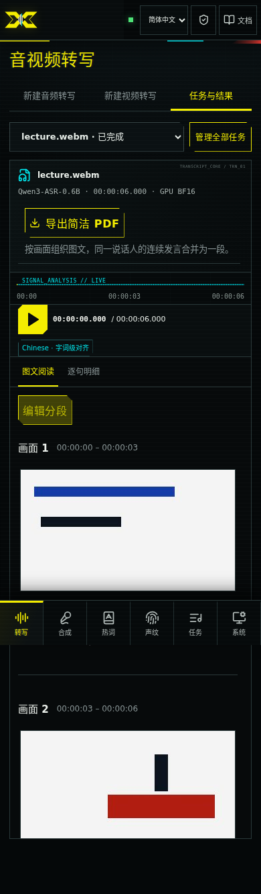
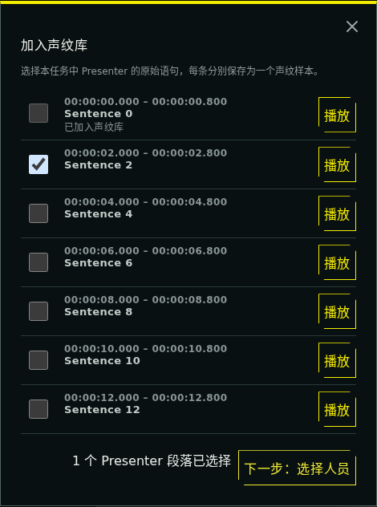
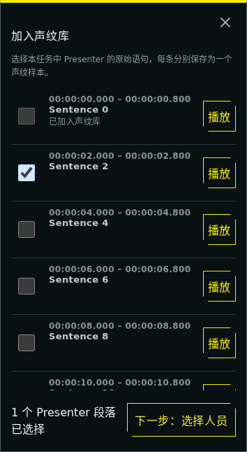

# 音视频转写 / Audio and video transcription

工作台分为「新建音频转写」「新建视频转写」「任务与结果」。音频与视频共用 ASR 队列，使用相同的模型、设备、热词和说话人能力。视频入口额外提供 PPT 区域框选和画面分析。

The workspace has separate audio/video creation tabs and a shared task/result tab. Both use the same ASR queue, models, devices, hotwords and speaker features. Video adds slide-region selection and presentation analysis.

## 上传 / Uploads

- 音频 / Audio: WAV, MP3, FLAC, M4A, AAC, OGG, OPUS, AIFF; 默认 / default **4 GiB** (`AUDIO_INTEL_MAX_UPLOAD_BYTES`).
- 视频 / Video: MP4, M4V, MOV, MKV, WEBM, AVI, MPEG, MPG, TS; 默认 / default **25 GiB = 26,843,545,600 bytes** (`AUDIO_INTEL_MAX_VIDEO_UPLOAD_BYTES`).容器必须有可解码的画面和音轨 / A decodable video track and audio track are required.
- 实际限制以 `GET /api/v1/capabilities` 的 `limits.max_upload_bytes` 和 `asr.video` 为准；容器扩展名不保证其中所有编解码器都可用。原音频 API 保持对音视频输入的兼容和原有上限；获得画面分析与 25 GiB 上限须使用视频 API。

Capabilities are authoritative; a container extension does not guarantee every codec within it is supported. The original audio API keeps its audio/video input compatibility and original limit. Use the new video API for presentation analysis and the 25 GiB limit.

视频采用顺序 32 MiB 分片，末片为剩余字节。暂停、断网或服务重启后，重新选择同一文件即可继续；浏览器重新计算已确认部分的 SHA-256，防止误接另一个文件。未完成上传最多 8 个，按剩余字节预留磁盘额度；保留磁盘安全水位。上传完成后才占用队列位置，队列满时可稍后再次提交。

Video uses sequential 32 MiB chunks, with a smaller final remainder. After pause, network loss or server restart, reselect the same file; confirmed chunks are verified against SHA-256 hashes before resuming. Up to eight unfinished uploads reserve their remaining bytes against disk admission. A completed upload takes a queue slot only when submitted; retry submission if the queue is full.

未完成上传闲置 **24 小时**或创建满 **7 天**后到期，每 15 分钟清理一次；「清理未完成上传」立即删除服务端残留。浏览器仅在 **sessionStorage** 保存上传 ID、幂等键、文件名/大小和提交设置，不保存文件内容；刷新保留，关闭页签或退出登录后清除浏览器记录，服务端仍按到期策略清理。已提交任务由普通任务删除机制管理。多页签不要同时续传同一上传。

Unfinished uploads expire after **24 idle hours** or **7 days from creation**, and are swept every 15 minutes. Explicit discard removes received bytes immediately. Browser **sessionStorage** holds only IDs, idempotency keys, filename/size and settings, never file bytes: reload preserves it; closing the tab or logging out clears the browser journal. Server expiry still applies. Submitted inputs belong to ordinary tasks. Avoid resuming one upload from multiple tabs simultaneously.

## 画面与讨论 / Images and discussion

面向 PPT 讲解、屏幕录制。新任务使用 presentation-v3，按约 0.5 秒抽样，结合变化面积、候选持续时间与内容边缘保留率判断切换；同一页逐步显示内容尽量合并，保留稳定完整画面。旧任务重试保留其原有 v1/v2 版本。非相邻的重复页面保留各自时间范围。默认最多 2,000 段，超过时明确失败并提示拆分源文件。这里的「关键帧」指内容代表画面，不是视频编码的 I 帧。

Designed for slides and screen recordings. New tasks use presentation-v3: samples about every 0.5 seconds combine changed area, candidate duration and content retention. Incremental builds are merged where possible, retaining a stable complete frame. Historical retries retain their original v1/v2 detector. Nonadjacent repeated pages retain separate time ranges. More than 2,000 sections fails explicitly with a request to split the source. These are content representatives, not codec I-frames.

视频时刻依据媒体 PTS，与音轨共用起点；音轨延迟以静音补齐，不按帧序号推算时间。跨页发言有完整可靠的逐词对齐时按词分配，否则整句归属时间重叠最多的一页，保持原文、不丢句。画面分析是启发式算法，不做 OCR 或语义理解；短于抽样/稳定窗口的页面、相似模板、复杂动画、镜头移动可能需要修正。带讲者小窗时可先框选 PPT 区域。

Media PTS provides a shared audio/video origin; delayed audio is padded with silence. Speech crossing a page boundary is split at aligned words only when alignment covers the original text; otherwise the whole sentence goes to the page with greatest time overlap. No text is dropped. Detection is heuristic, without OCR or semantic understanding. Very short pages, similar templates, complex animation or camera movement may need correction. Crop to the slide region when a speaker inset interferes.

前端通过“画面检测”管理检测结果和导出隐藏画面。与下一段合并、拆分、调整结束时间、更换截图和恢复自动分段仅保留 API 支持。修订号避免覆盖其他客户端的修改；遇到冲突，关闭编辑器并重新加载分段。原始逐句文本与说话人快照保持可查看。

The frontend no longer exposes manual section editing. Backend APIs retain merge-next, split, boundary adjustment, replacement images and restoration of automatic sections, with revision checks preventing concurrent overwrites. Original detailed text and speaker snapshots remain accessible.

## 音频增强 / Audio enhancement

网页使用一个“音频增强”总开关。视频 API 推荐在 `/api/v1/asr/video-jobs` JSON 中使用
`audio_enhancement=auto|off`，
新任务默认 `auto`。上传与断点校验不处理媒体；增强在现有 ASR 任务的 CPU 子阶段运行，
保留采样数、视频时间原点和说话人识别的原音输入。默认回放原音，实际增强后可切换或
下载独立增强音。旧版上传恢复原设置，历史任务不补生成。详见[人声增强](ASR_ENHANCEMENT.md)。

The browser uses one Audio enhancement checkbox. Video JSON recommends
`audio_enhancement=auto|off`, defaulting to `auto`. Independent booleans remain
supported for compatibility and cannot be mixed with the combined control (422). Upload/resume
verification does not process media. The existing ASR task enhances on CPU while
preserving sample count, video time origin and original audio for diarization.
Applied results offer an enhanced track; original playback remains the default.
Paused uploads retain their saved settings, including independent combinations;
pre-enhancement uploads stay off. Historical jobs are not backfilled. Denoising
and gain report their outcomes separately; partial success can still provide an
enhanced track. See the [enhancement contract](ASR_ENHANCEMENT.md).

独立布尔参数继续兼容 API 调用，但不能与总开关混用（422）。暂停上传保留原参数，
包括旧的独立组合；缺少增强字段的旧上传仍按关闭处理。降噪失败不阻断增益，是否生效
以结果中两项的实际状态为准。

原音／增强音控件将“试听”分段选择与“下载原音／下载增强音”分组，手机上两组分行。
下载原音提供播放器中未增强的 WAV（视频任务同样下载音轨 WAV），不改变试听音轨或进度。
没有增强音时仅提供原音下载；历史任务未保留原音 WAV 时显示不可用，不自动补生成。

Original/enhanced track selection is grouped separately from the two downloads; mobile uses two rows.
Original download serves the saved unenhanced playback WAV, including the audio track of video jobs,
without changing listening state. Jobs without enhanced audio offer only original download;
historical jobs without a saved original WAV show an unavailable explanation and are not backfilled.

<a id="pdf-与磁盘--pdf-and-disk-use"></a>

## 简洁导出与磁盘 / Concise export and disk use

音视频提供主操作「简洁导出」，可选择 PDF 或 Word（DOCX），次级「明细与字幕」保留 JSON、TXT、SRT、VTT。简洁 PDF/DOCX 将相同 speaker ID 的相邻发言合并为一段，保留第一句开始与最后一句结束时间，不删改口头语、不做总结；同名但不同 ID 的说话人不会误合并。视频也支持 JSON、TXT、SRT、VTT，并提供图文简洁 PDF/DOCX，按画面分段，画面下展示相应讨论。PDF 内嵌本地简体中文字体，无云服务或系统字体依赖。

Audio and video offer a concise export menu with PDF and editable Word (DOCX) and a secondary details/subtitles menu. Adjacent speech with the same speaker ID merges with its combined time range; words and disfluencies are preserved. Equal names with different IDs do not merge. Video offers illustrated concise PDF/DOCX, with images followed by their discussion. A bundled Chinese font keeps PDF rendering offline.

上传直接顺序追加到一份文件，校验并 fsync 后才确认偏移；不创建分片文件再拼接、不预分配 25 GiB，不在重试时重写已确认数据。提交时同盘重命名。画面分析保存最终代表 JPEG；v2 另保存有上限、可重建的低分辨率压缩特征缓存，不保存高分辨率抽样序列。原音复用一份归一化 WAV；实际应用人声增强时另存一份增强 WAV，约每小时 115 MB，旁路时不增加；临时目录和数据目录在同一文件系统时完成阶段直接移动，否则跨盘移动需一次复制。失败/取消后的工作目录由现有 worker 清理。PDF 按需在内存生成，单渲染并发、64 MiB LRU 缓存（5 分钟）；单份 PDF 输入上限为 400 万文本字符、128 MiB JPEG，超过返回 413 并提示拆分。预览最多两个解码器且不写磁盘。修改截图后清理不再被当前/原始分段引用的图片，删除任务清理其输入与结果。

Uploads append to one file and are acknowledged only after checksum verification and fsync: no chunk concatenation, full-size preallocation or acknowledged-byte rewrite. Submission renames on the same filesystem. Final JPEG representatives are saved; v2 also saves bounded, rebuildable compressed low-resolution features, not a full-resolution sampled-frame sequence. One normalized WAV preserves original playback; applied enhancement retains a separate WAV (about 115 MB/hour), while bypass adds no file. Keep temporary and data directories on the same filesystem for rename-only completion; crossing filesystems requires one copy. Existing worker cleanup removes failed/cancelled working directories. PDFs render on demand in memory, with one renderer and a 64 MiB, five-minute LRU. PDF inputs are limited to 4 million text characters and 128 MiB of JPEGs; larger exports return 413 with a split-source hint. At most two preview decoders run, without writing images. Unreferenced edited images are removed, and task deletion removes owned inputs/results.

算法选择参考：[FFmpeg scdet](https://ffmpeg.org/ffmpeg-filters.html#scdet)、[PySceneDetect 检测器](https://www.scenedetect.com/docs/api/detectors.html)。后者提供内容/自适应切镜，但不直接判断 PPT 的同页动画，因此 v1 复用 FFmpeg 并加入幻灯片比较，v2 使用统一的面积／持续时间门槛；均不增加 OpenCV 或模型运行时。

## 客户端示例 / Client example

```bash
AUDIO_INTEL_BASE_URL=http://127.0.0.1:20810 \
  .runtime/api/bin/python scripts/submit_video.py lecture.mp4 --state tmp/lecture-upload.json --pdf tmp/lecture.pdf
```

Windows 使用 `.runtime\api\Scripts\python.exe`。可选 `--device cpu` / `--device gpu`；省略则采用部署默认。鉴权从 `AUDIO_INTEL_API_KEY` 读取。中断后使用同一 `--state` 和原文件重跑；收到 429 时按 `Retry-After` 等待后重跑。上传过期后使用新的状态文件。完整接口见 [API 文档](API.md) 与本地 `/docs`。

On Windows use `.runtime\api\Scripts\python.exe`. Optional `--device` overrides the deployment default. Authentication comes from `AUDIO_INTEL_API_KEY`. Rerun with the same state and file after interruption; on 429, wait for `Retry-After` before rerunning. Use a new journal after expiry. See [API documentation](API.md) and local `/docs`.

## 界面示例 / Interface examples

以下使用两页合成测试视频与 mock 转写内容，展示图文阅读与编辑控件；不是实际会议数据。 / These screenshots use a two-slide synthetic test video and mock transcript, not a real meeting.





## 恢复与编辑状态 / Recovery and editing state

续传先显示“正在校验已上传内容”：分母是服务端已确认的字节数，分子是本次已校验的字节数；通过后切换到整份文件的上传进度，从确认偏移继续。两种百分比分别表示本地校验与网络传输，均不是推理进度；校验和传输均可暂停。

Resume first verifies local bytes against the server manifest. Verification percentages use confirmed bytes as their total; upload percentages use the whole file and resume at the confirmed offset. Both stages can be paused and neither represents inference progress.

图文阅读不再提供“编辑分段”及手工修改按钮。使用“画面检测”查看当前结果、预览新检测并管理导出画面。手工分段编辑 API 继续支持修订检查；历史人工编辑不会自动消失。

The reading UI no longer exposes manual section editing. Picture detection shows current pictures, generates detection previews and manages export visibility. Manual section-editing APIs retain revision checks; existing manual edits remain intact.

PDF/DOCX 下载通过一次 POST 接收完整内容后保存。429 按 Retry-After 等待后手动重试，413 表示超出导出上限，应拆分源文件重新转写；音频还可下载明细与字幕。401 重新登录后再导出，断网直接重试导出，无需重新转写。

PDF/DOCX uses a single POST and saves after the full response arrives. For 429, wait for Retry-After then export manually; for 413, split the source and transcribe smaller files, or use audio detail/subtitle exports. Sign in again after 401. Retry an interrupted download without submitting a new transcription.

命令行 `--pdf` 期间续传文件还保存已接受的 `job_id`，直到 PDF 完整写入临时文件、关闭并原子替换目标文件后才清除。轮询中断、下载失败、任务失败或取消均保留记录，重跑只查询原任务；确需新任务时使用新的 `--state`。已有完整 PDF 不会被失败下载破坏。省略 `--pdf` 时，提交成功即清除记录。旧记录可继续使用；恢复时沿用记录中的转写设置。

With CLI `--pdf`, the journal retains the accepted `job_id` until the download is fully written, closed and atomically replaces the destination. Interrupted polling/downloads and failed/cancelled jobs retain the journal; rerunning reads the same job. Use a new `--state` for an intentional new job. Failed downloads preserve existing complete PDFs. Without `--pdf`, successful submission clears the journal. Legacy journals remain readable and saved transcription parameters are retained on resume.

编辑模式 / Editing mode:


## 从视频加入声纹库 / Add video speech to the voiceprint library

在「图文阅读」中点击说话人旁的「加入声纹库」，即可试听并勾选该人在整个任务中的原始语句，然后选择已有人员或新建人员。默认预选点击段落所包含、尚未入库的原始语句；每条语句单独保存为一个样本，跨画面重复显示的语句不会重复列出。已入库语句不可再次选择。声纹库加载失败可重试，提交失败保留输入。也可继续使用「逐句明细」中的勾选入库入口。

样本使用与转写和播放相同时间轴的音频，包含视频起始偏移和延迟音轨处理；缺少任务保存的播放音频时明确报错，不自动重建历史文件。关闭弹窗会停止试听，选择仅在当前弹窗内保留。

图文阅读每批展示 20 个画面，接近底部时自动追加；「加载更多」按钮仍可手动使用。逐句明细继续按每批 40 条加载。

English: In **Illustrated reading**, choose **Add to voiceprint library** beside a speaker. Preview and select original sentences across the task, then choose an existing person or create one. The clicked paragraph’s original sentences are preselected, excluding previously imported ones; each sentence becomes one sample, and repeated scene references appear only once. Previously imported sentences are disabled. Library loading and submission errors support retry. The existing selection flow in **Segment details** remains available. Video samples use the saved playback audio on the transcription timeline, including media offsets and delayed audio; missing playback is reported without rebuilding historical files. Closing the dialog stops preview and clears its temporary selection. Scenes load automatically in batches of 20 near the bottom, with a manual **Load more** fallback; segment details retain batches of 40.

| 桌面语句选择 / Desktop selection | 390 px 语句选择 / Mobile selection |
| --- | --- |
|  |  |

截图使用合成测试数据 / Screenshots use synthetic test data.

## 分组与脱敏导出 / Groups and redacted export

音视频任务均可选择多个声纹分组，默认全部，提交时固定人员 ID。PDF、DOCX、JSON、TXT、SRT、VTT 下载默认脱敏，可关闭；只处理下载副本，原始结果、音频和截图不改写。关键词每行 `原词=替换词`，最多 100 对，浏览器长期记忆开关和规则。具体算法、边界和接口见 [API 指南](API.md#on-demand-redacted-transcript-export--按需脱敏导出)。

CLI 的 `--voiceprint-group ID` 可重复选择分组，省略使用全部；`--pdf` 默认脱敏，`--no-redact` 导出原文，`--replacements rules.json` 接收 UTF-8 `{source,target}` 数组。中断后沿用原续传记录和已接受任务，不重新计算任务范围；导出选项在下载时应用。

English: Select voiceprint groups for audio/video; eligible people are fixed at acceptance. All transcript formats default to redacted downloads, preserving original results/audio/images. CLI `--voiceprint-group ID` repeats, `--pdf` redacts by default, `--no-redact` exports raw, and `--replacements` reads a UTF-8 JSON array. Export options are applied at download time; resumed accepted jobs keep their scope.

## 阅读连续性与时间输入 / Reading continuity and time input

图文阅读和逐句明细分别记住当前任务的位置与已加载数量，刷新页面也可继续阅读；逐句搜索和说话人筛选一并恢复。编辑、合并、拆分后以分段 ID 和时间恢复附近位置。刷新期间保留旧内容并显示状态，修改按钮暂时禁用；失败时可重试。记录只在当前页签 sessionStorage 保存，退出登录或鉴权失效清除，详见[工作台指南](WORKSPACES.md)。

手工更换截图、拆分和调整结束时间现在仅通过 API 提供，时间参数使用秒数。截图时刻允许等于分段起点，必须小于终点；拆分与边界必须严格在对应范围内。服务端继续校验范围与修订号。

桌面保留 PDF 快捷按钮和“明细与字幕”菜单；窄屏使用“导出转写”弹窗统一选择 PDF/TXT/SRT/VTT/JSON、脱敏开关和替换规则。菜单支持点击外部或 Escape 关闭，不改变阅读滚动。规则错误即时显示；仅在脱敏开启时阻止下载，关闭开关可继续导出原文。声纹入库分两步，显示已选数量、固定操作区，回到上一步保留勾选。

English: Each task/view retains its reading anchor and loaded count across navigation/reload, including segment filters. Edited sections restore a nearby ID/time anchor. Refresh keeps old content visible, disables editing and provides retry on failure. Current-tab sessionStorage clears on logout/auth invalidation. Manual frame/section edits are API-only and accept seconds; server time-range and revision validation remains authoritative. Narrow screens consolidate transcript formats/redaction/rules into one export dialog. Desktop menus dismiss on outside click/Escape. Invalid rules block downloads only when redaction is enabled. Enrollment preselects clicked-paragraph sentences, retains selections between its two steps and keeps footer actions reachable.

高级设置分别配置 `speech_enhancement_strength`（0–2，默认 1）与 `background_denoise_strength`（0–1，GTCRN 默认 0.5），视频提交 JSON 保存两项力度。Capabilities 公布实际范围／默认值；仅影响新提交任务，暂停上传保留原参数。Advanced strengths and reset share audio ASR preferences; paused uploads keep their saved snapshot.

## 视频结果时间轴 / Video result timeline

视频结果默认常显波形，上方为对应画面段的代表截图，共用同一时间刻度。“画面目录”列出全部画面段，与正文的“画面 1、画面 2…”对应。每个画面段是一段时间，代表截图取自该段中的某一时刻；预览分别标注“对应时段”和“截图时刻”。全片视图会省略放不下的缩略图，放大后显示更多，目录始终保留全部画面。

初始显示全片，可×2／÷2缩放（最小10秒，短视频以全长为限）。横向滚动条由页面绘制并始终可见，不随系统滚动条设置自动隐藏；滑块长度表示当前可见范围，全片视图时满宽且不可拖动。放大后可拖动滑块、点击轨道或使用触控板横滑浏览；手机也可横向拖动滑块或缩略图区。聚焦滚动条后，方向键移动可见范围的 10%，PageUp／PageDown 或点击空白轨道移动 90%，Home／End 到两端。横向浏览只改变可视窗口，不改变播放位置，并暂停自动跟随。播放点移出窗口时，“定位播放点”按钮可将窗口移回并恢复跟随；选择画面或操作波形也恢复跟随。正常纵向滚动不被时间轴拦截。

悬停或键盘聚焦缩略图显示预览，Escape／离开关闭。选择画面定位到 `scene.start`；代表截图的 `frame_time` 可能位于该段末尾，不用作跳转时间。点击波形保留准确点击时间，并同步定位、高亮图文阅读或逐句明细中的对应内容；拖动波形在松开时定位正文，键盘操作同样支持。静音间隔定位后续最近语句，片尾定位最后一句，播放时间保持所选值。所有定位保留播放／暂停状态；正常播放只更新高亮，不持续滚动正文。

主动从画面目录、缩略图或波形定位逐句明细时，会清除搜索和说话人筛选，以显示目标语句；切换阅读模式仍恢复各自的位置。浏览器存储期限不变。编辑画面段后，阅读区与时间轴共用修订结果并同时更新。

结果页的增强状态位于音频下载旁，点击简短状态按钮查看设置强度、逐项处理状态和原因；设置强度不代表每一项一定已执行。较窄的结果卡片将原音／增强音下载收进“下载音频”菜单。内容区直接展示子页签，阅读模式与当前模式工具共用一行，正文独立滚动；手机和极矮窗口允许页面纵向滚动。时间轴横向滚动条占位固定，放大不会再挤出一整行平移控件。

English: The scene directory lists every interval and matches the numbered illustrated sections. Thumbnails are representative frames; previews distinguish the interval from the frame capture time. Zoom in to see more thumbnails. After zooming, browse with the persistent page-rendered scrollbar, a horizontal trackpad gesture, or a touch drag over the bar or thumbnails. The bar remains visible regardless of OS auto-hide preferences; its length represents the visible range and it is disabled in full view. Focused arrow keys move 10% of the visible range; PageUp/PageDown and empty-track clicks move 90%; Home/End go to the boundaries. Browsing does not seek and pauses following. Locate playhead restores following without changing playback time; explicit waveform/scene navigation also resumes following. Vertical scrolling remains available.

Scene selection seeks to the interval start. Waveform clicks seek to the exact chosen time and reveal/highlight the illustrated paragraph or detailed sentence; dragging reveals the reader on release, and keyboard navigation does the same. Gaps reveal the next sentence and the endpoint reveals the final sentence without changing the selected time. Playback state is preserved. Playback ticks highlight without repeatedly scrolling the reader. Explicit navigation clears detailed-reader search/speaker filters; switching views still restores their independent bookmarks and storage lifetime is unchanged.

Audio processing is a compact status button beside downloads; its popover shows configured strengths, actual statuses and reasons. Narrow result cards combine both audio downloads into one menu. Desktop controls leave the remaining height for the reader; mobile/very short windows allow page scrolling. Waveform requests remain limited to the visible saved audio window. No historical media rewrite, API or inference-pipeline change is required.

## 结果页画面检测 / Picture detection in results

在「任务与结果 → 图文阅读 → 画面检测」设置最小画面变化比例（默认 3%，0.5–50%）与新画面最短保持时间（默认 1 秒）。具体范围与默认值以 capabilities 为准。同页增量显示尽量合并。

presentation-v3 将分段和截图确认分开：截图需要在同一分段内连续稳定达到用户配置的 `min_stable_seconds`，与音频、句子时长无关。截图使用独立的降噪容差（显著颜色变化面积低于 0.4%），小通知不能因低于分段面积阈值而绕过确认。多个合格区间采用最后一个区间的首个实际采样帧；短暂变化不覆盖已确认截图。无合格画面时 `image`、`frame_time` 和预览 `preview_url` 为 null，界面与 PDF/DOCX 显示“无稳定画面”，文字和时间段保留；这不是加载错误或导出隐藏。分段范围与截图时刻分别显示。

保持时间范围仍为 0.5–5 秒，输入步进 0.1 秒（如 0.6）；约每 0.5 秒抽样，按实际时间跨度确认，不提前、跨分段或在片尾补足时长，因此非抽样间隔整数倍的设置可能等到下一个抽样点。检测仍是有容差的视觉启发式，不进行 OCR/通知语义识别。自动截图遵守此规则；明确手工指定截图的 API 保留原有语义。

Presentation-v3 separates sections from screenshot confirmation. Automatic pictures require a continuous sampled stable interval inside one section lasting at least the configured `min_stable_seconds`, independently of audio or sentence length. A separate noise tolerance (significant RGB changes over less than 0.4% of pixels) prevents section-area settings from bypassing screenshot confirmation. The first actual sample of the latest qualifying interval represents the section; brief changes cannot overwrite it. Without a qualifying picture, `image`, `frame_time` and preview `preview_url` are null. The reader, detection dialog, timeline and PDF/DOCX show No stable picture while preserving text, ranges and navigation; this is distinct from loading failure and export hiding. Section ranges and capture times are labeled separately.

Duration remains 0.5–5 seconds with a 0.1-second input step, including 0.6. Sampling remains about 0.5 seconds. Confirmation uses observed elapsed time without early acceptance, crossing sections or padding EOF; fractional settings may wait until the next sample. This remains a noise-tolerant visual heuristic without OCR or notification recognition. Explicit manual frame selection retains its API semantics.

打开「画面检测」即显示当前画面及导出隐藏标记，无需先检测。点击「预览检测」后比较当前／候选画面，再点击「应用预览」；应用后弹窗保持打开。预览不改变结果，也不重跑音频转写；存在人工分段或截图修改时须勾选替换确认。其他客户端修改分段后必须重新预览。应用保留原转写文字、说话人和时间戳，更新画面及讨论归属。API 的 restore 操作恢复最近一次成功应用的自动分段；首次自动分段快照仍保留。旧结果不自动重算，旧任务重试沿用原算法。

Opening Picture detection shows current pictures immediately. Preview the candidate count, times and images before applying; applying keeps the dialog open for export visibility selection. Preview leaves the result unchanged and does not rerun ASR. Replacing manual sections or images requires explicit confirmation. Concurrent edits require a new preview. Apply preserves transcript text, speaker identities and timestamps while updating picture boundaries and discussion grouping. The backend restore action restores the most recently applied detection; the first automatic snapshot remains available. Legacy results are not recomputed automatically and retries retain their original detector.

应用成功后，浏览器在独立的 `audio-intel:video-scene-detection:v1` localStorage 中保存这两项参数，刷新、关闭浏览器或退出登录后保留，用于该浏览器后续提交的视频；其他浏览器使用各自偏好。已有任务优先显示自己的实际设置。「恢复默认值」只重置待预览参数，重新预览并应用后才更新任务和偏好。未应用草稿关闭弹窗即丢弃。新建页不增加控件，暂停上传继续使用上传开始时保存的参数。

After successful apply, the two settings are saved in the browser's independent `audio-intel:video-scene-detection:v1` localStorage, surviving reload, browser close and sign-out, and used for subsequent videos submitted from that browser. Existing tasks display their own applied settings. Restore defaults changes only the pending controls; preview and apply to update the task and preference. Closing the dialog discards unapplied drafts. Creation forms add no controls; resumed uploads retain their original submission snapshot.

首次分析顺带生成分块压缩的本地特征缓存，旧任务首次预览时补建。缓存位于任务目录，计入任务空间占用，删除任务时一起清理；每任务最多 512 MiB，超限或缓存失败可重新扫描，不影响转写成功。预览在独立 CPU 进程运行，全局最多一个，最多保留八份已完成预览；30 分钟或服务重启后失效。取消等待进程退出。全部图片、缓存和计算都留在本地。

Initial analysis builds a chunk-compressed local feature cache; legacy tasks build it on first preview. Job-owned caches count toward storage and are deleted with the job. The 512 MiB per-job budget is optional: cache failure/exhaustion falls back to scanning without failing transcription. A separate CPU process handles previews, with one active computation and at most eight completed previews. Previews expire after 30 minutes or a service restart; cancellation waits for process exit. Pictures, caches and computation remain local.

```bash
# Replace the example ID with a completed local video job; omit --apply to inspect only.
AUDIO_INTEL_BASE_URL=http://127.0.0.1:20810 \
  .runtime/api/bin/python scripts/preview_video_scenes.py 0123456789abcdef0123456789abcdef \
  --min-change-percent 3 --min-stable-seconds 1
```


## 导出画面显示 / Export picture visibility

“画面检测”的当前画面每批展示 12 张，接近底部自动加载下一批。可勾选一张或多张、全选已加载画面，再选择“导出时隐藏”或“恢复导出”；“全部恢复”恢复所有画面。操作立即随任务保存，刷新或换浏览器后仍有效。保存失败保留选择；修订冲突需关闭并重新打开。

隐藏仅影响导出：PDF/DOCX 用“画面已隐藏”占位框替代图片，编号、时间和文字保留；JSON 携带隐藏标记，TXT/SRT/VTT 保持完整文字。图文阅读显示原图及“导出时隐藏”标记，时间轴和原媒体不变。文字脱敏关闭时，画面隐藏仍生效。

候选检测预览须先应用，再设置隐藏。修改任一检测参数并成功应用会清除旧标记；单纯修改输入、恢复默认输入、预览或取消均不清除。同参数重新应用仅保留时间范围、代表帧时间和图片均一致的标记。保存隐藏设置会使尚未应用的预览失效；参数保留，可重新预览。

English: Picture detection immediately shows current pictures and export-hidden badges. It loads 12 pictures per batch automatically near the bottom. Select individual or loaded pictures, then Hide in exports, Restore in exports or Restore all. Changes are saved with the task across browsers. Failed saves retain selection; revision conflicts require closing and reopening. PDF/DOCX use a Picture hidden placeholder while retaining section numbers, times and text; JSON includes markers and text formats remain complete. Illustrated reading shows original pictures with export-hidden badges; timeline and source media remain unchanged. Picture hiding is independent of text redaction. Candidate previews must be applied before setting visibility. Applying changed detection parameters clears old markers; editing inputs, resetting inputs, previewing or cancelling does not. Unchanged parameters preserve markers only for identical time ranges, frame times and images. Saving visibility invalidates pending previews without clearing their input settings.

### 可编辑 Word 导出 / Editable Word export

简洁导出菜单的 Word（DOCX）使用与 PDF 相同的段落、时间范围和画面分组，文字可编辑。手机在现有导出弹窗选择 DOCX，默认仍为 PDF，不新增格式偏好存储。隐藏画面显示“画面已隐藏 / Picture hidden”，包内不嵌入被隐藏的原图，讨论文字保留；关闭文字脱敏也不会取消隐藏。历史已完成任务无需重新转写。

DOCX 完全本地生成，复用已安装的 python-docx 1.2.0，无新增依赖或数据库迁移。中文使用文档字体样式而非嵌入字体，Word/WPS 的字体替代和分页可能不同于 PDF。

English: Choose Word (DOCX) in Concise export, or in the mobile format selector (PDF remains the default). Editable documents preserve the same paragraphs, times and picture grouping as PDF. Hidden pictures use placeholders without embedding their original bytes; text remains, independently of text redaction. Existing completed jobs work without retranscription. Generation is offline using the already pinned python-docx library, with no new dependencies, migration or browser-storage policy. Fonts are not embedded, so Word/WPS pagination may differ from PDF.
